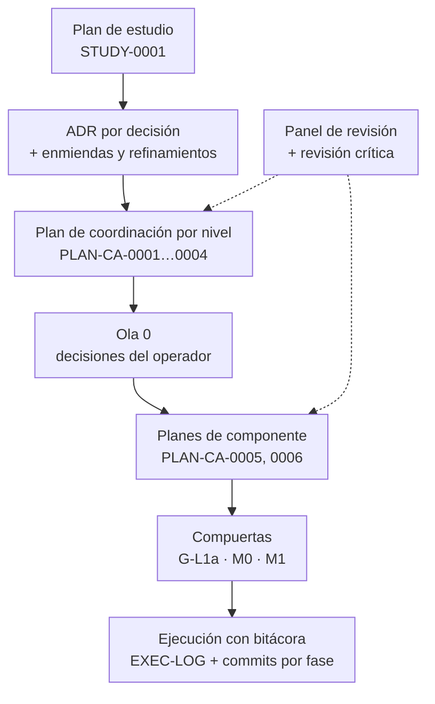
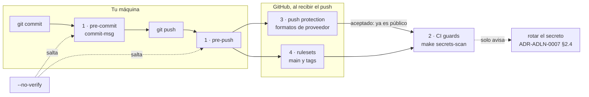
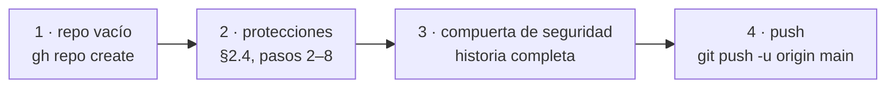
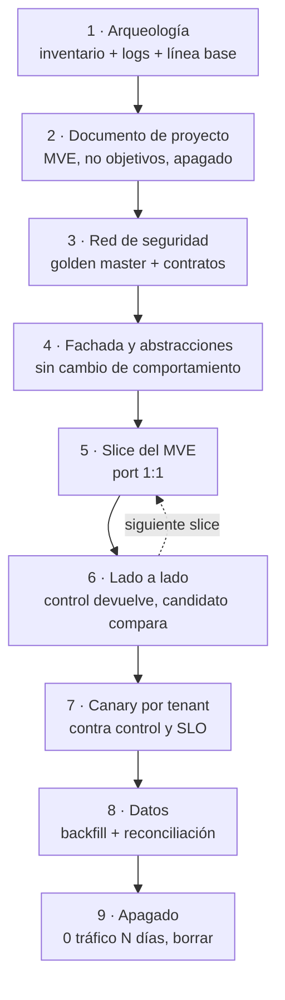

# 00 — Protocolo de desarrollo full stack

**Qué vas a aprender.** Cómo se planeó y se construye AdmitLens, contado mientras ocurre: qué se tuvo en cuenta, con qué herramienta se decidió cada cosa (ADR, enmiendas, planes, olas y compuertas), qué quedó por defecto y qué salió mal. La meta es un protocolo reutilizable para la próxima aplicación full stack de nivel mid+. Incluye además una guía paso a paso para proteger un repositorio público en GitHub y un protocolo para refactorizar o migrar un sistema que ya está en producción.

**Para quién.** Para quien dirige un proyecto de software y tendrá que explicar cómo trabaja: en un equipo, ante un cliente o en una entrevista.

**Cómo leerla.** Es una **nota viva**. Crece por secciones fechadas: una al cerrar la ola 0, otra al cerrar cada plan de componente y otra en el cierre registrado de cada nivel. **Ninguna sección anterior se reescribe**: si algo cambia, lo cuenta la sección siguiente. Las decisiones se citan por su identificador (ADR-ADLN-0007, PLAN-CA-0005, D-0013…); esos documentos viven en las notas privadas del proyecto, y esta nota cuenta lo que deciden. El proceso se describe por roles: el **operador** (quien decide y responde por la cuenta), el **orquestador** (quien planea, integra y verifica), el **revisor de código**, el **auditor de seguridad**, el **responsable de documentación** y los dueños de cada parte del código.

## Contenido

1. [Sección 1. Del papel al primer commit](#sección-1-del-papel-al-primer-commit) (2026-10-17)
   - [1.1 La cadena de planeación](#11-la-cadena-de-planeación) · [1.2 Dos orquestadores](#12-dos-orquestadores) · [1.3 Decisiones clave](#13-decisiones-clave) · [1.4 Qué quedó por defecto o al azar](#14-qué-quedó-por-defecto-o-al-azar) · [1.5 Checklist](#15-checklist-reutilizable-para-la-próxima-app-mid) · [1.6 Preguntas](#16-preguntas-de-repaso)
2. [Sección 2. Salvaguardas de un repo público en GitHub](#sección-2-salvaguardas-de-un-repo-público-en-github) (2026-10-18)
   - [2.1 El modelo por capas](#21-el-modelo-por-capas) · [2.2 La cuenta](#22-prerrequisitos-de-la-cuenta-ui-web) · [2.3 Pasos de git](#23-pasos-de-git-en-orden) · [2.4 Pasos de gh](#24-pasos-de-gh-en-orden) · [2.5 El orden](#25-el-orden-recomendado-y-por-qué) · [2.6 Acuerdo de trabajo](#26-acuerdo-de-trabajo) · [2.7 Dependabot](#27-qué-pasa-con-dependabot) · [2.8 Referencias](#28-referencias) · [2.9 Preguntas y checklist](#29-preguntas-de-repaso-y-checklist)
3. [Sección 3. Cuando el sistema ya existe](#sección-3-cuando-el-sistema-ya-existe) (2026-10-18)
   - [3.1 La misma cadena](#31-la-misma-cadena-con-otra-pregunta-en-cada-pieza) · [3.2 Las referencias](#32-lo-que-enseñan-las-referencias-leídas-a-fondo) · [3.3 Nueve pasos](#33-el-protocolo-de-migración-en-nueve-pasos) · [3.4 AdmitLens](#34-qué-significa-para-admitlens) · [3.5 Anti-patrones](#35-anti-patrones) · [3.6 Checklist](#36-checklist-reutilizable-para-un-sistema-existente) · [3.7 Preguntas](#37-preguntas-de-repaso) · [3.8 Correcciones](#38-qué-corrige-esta-sección) · [3.9 Referencias](#39-referencias-releídas-para-esta-sección)
4. [Sección 4. Cerrar L1-P1](#sección-4-cerrar-l1-p1) (2026-10-18)
   - [4.1 Lo pendiente](#41-lo-que-la-sección-2-dejó-pendiente) · [4.2 Decisiones](#42-qué-se-decidió-y-con-qué-herramienta) · [4.3 Qué salió mal](#43-qué-salió-mal-o-casi) · [4.4 Checklist](#44-checklist-lo-que-se-añade) · [4.5 Preguntas](#45-preguntas-de-repaso) · [4.6 Lo que falta](#46-lo-que-falta-para-el-cierre-registrado)
5. [Para practicar](#para-practicar)
6. [Historial](#historial)

---

## Sección 1. Del papel al primer commit

*2026-10-17. Cómo se planeó AdmitLens hasta la ola 0. Fuentes: la bitácora del proyecto, el registro de revisiones de los planes PLAN-CA-0001, 0005 y 0006, y la bitácora de ejecución de PLAN-CA-0005.*

### 1.1 La cadena de planeación



| Pieza | Qué es | Qué evita | En AdmitLens |
| --- | --- | --- | --- |
| **Plan de estudio** | Qué se aprende y en qué orden | Crecer sin objetivo | STUDY-0001 |
| **ADR** | Una decisión con sus alternativas rechazadas | Rediscutir lo decidido | Del 0001 al 0013, en estado `proposed` y `staged` en el registro de decisiones |
| **Enmienda** | Cambia **dónde vive una pieza**, sin tocar el estado del ADR | Un ADR por cada ajuste de estructura | Enmienda 1 de los ADR 0001 a 0003 y 0007 |
| **Refinamiento** | Precisión de texto anotada en la bitácora | Burocracia por ambigüedades menores | La pregunta Q5 refina ADR-ADLN-0001 §E1.2 |
| **Plan de coordinación** | Componentes, contratos K, olas, compuertas y decisiones D de un nivel | Trabajo en paralelo que se pisa | PLAN-CA-0001 a 0004 |
| **Plan de componente** | Un plan hijo por componente, con dueño | Olas imposibles de verificar | PLAN-CA-0005 (L1-P1) y 0006 (L1-P2) |
| **Panel de revisión** | Revisores de solo lectura en paralelo, más una revisión crítica del borrador | El punto ciego del autor único | La revisión crítica pidió cambios (REVISE) en los seis planes |
| **Ola 0** | Decisiones del operador antes de construir | Que lo irreversible se decida sin el responsable | D1–D10 de PLAN-CA-0001 |
| **Compuerta** | Condición verificable para avanzar | Construir sobre algo sin probar | G-L1a (contrato K0 firmado), M0 (`make db-up` sano), M1 (migración `0001` aplicada) |
| **Ejecución con bitácora** | Cada paso registrado, con commits por fase | No saber qué se hizo | Un commit `[Pre-Implementation]` vacío al empezar |

**¿Enmienda o ADR nuevo?** Cambiar una decisión exige un ADR nuevo. Por eso Postgres en el nivel 1 no fue la «Enmienda 2» de ADR-ADLN-0001, sino ADR-ADLN-0010 (su alternativa B lo explica). Un plan en borrador y sin ejecuciones sí se enmienda en su lugar, con una entrada en su registro de revisiones.

> **Anti-patrón:** aceptar como evidencia lo que reporta quien ejecutó.
>
> **Patrón:** el orquestador re-ejecuta cada compuerta y guarda la hora, el `HEAD` y el código de salida (PLAN-CA-0001 §7).

### 1.2 Dos orquestadores

- **Cómo:** el orquestador principal implementa el nivel 1; el secundario hace un boceto del nivel 2 en la rama `sketch/level-2`, en su propio worktree, y cierra cada tramo con un reporte de actividad. Solo el principal hace merge a `main` y push, con la confirmación del operador (ADR-ADLN-0007 §E7.9).
- **Por qué:** los niveles 2 a 4 dependen de contratos del nivel 1 (el esquema K0, el dominio); trabajar en serie deja sesiones paradas. Los worktrees existen porque dos sesiones de trabajo no pueden cambiar de rama en el mismo directorio.
- **El riesgo y su control:** el boceto puede divergir del código real, así que las compuertas entre niveles pasan a ser de **promoción**: el nivel 1 cerrado y `make parity` en verde (ADR-ADLN-0013 §2.1).

### 1.3 Decisiones clave

| Decisión | Por qué | Alternativa rechazada |
| --- | --- | --- |
| **PostgreSQL 16 desde el nivel 1** y un estándar de datos: `timestamptz` en milisegundos, `…sssZ` en el cable, JSONB (ADR-ADLN-0010) | Un solo dialecto en los cuatro niveles; la cadena de fecha coincide con `toISOString()` de JavaScript | SQLite (Alt A); tipos genéricos convertidos más tarde, porque `AT TIME ZONE` puede desplazar horas sin error (Alt C) |
| **Ningún artefacto de las herramientas locales en el repo** (ADR-ADLN-0007 §E7.8) | Repo público y semilla de otros proyectos | Versionar la configuración local, con sus rutas locales |
| **Commits con plan y estado, sin ciertos trailers de coautoría generados por herramientas** (ADR-ADLN-0012) | El mensaje codifica el plan y el estado de ejecución | Conventional Commits (Alt E); mantener esos trailers (Alt A) |
| **Sin tags; cierre registrado** (ADR-ADLN-0013) | Con cuatro niveles conviviendo, un tag nombra el estado de todo el repo | Tags por nivel como `level-1/closed` (Alt B) |
| **Make como única puerta** (ADR-ADLN-0007 §E7.4) | El operador y CI corren lo mismo; ningún secreto pasa por variables de Make | Exigir `gmake` 4.x (PLAN-CA-0005 §6.5) |
| **Guardas por capas** (PLAN-CA-0005 §6.1) | Con push directo a `main`, CI **detecta** pero no **previene**; los custom patterns no existen en repos personales; gitleaks sin `-m` no ve los merges (medido con canarios) | Solo gitleaks; el framework `pre-commit` |
| **El contrato K0 firmado con una huella** (PLAN-CA-0006 §8) | Dos sesiones consumen el contrato; el sha256 del bloque lo hace comprobable, y el nivel 2 lo recalculó | Confiar en que «es el mismo texto» |

> **Anti-patrón:** prevenir fugas solo en el CI de un repo público. Cuando avisa, el secreto ya es público.
>
> **Patrón:** prevenir antes del push (permisos locales de las herramientas, `.gitignore`, hooks, push protection) y detectar en CI. Cada hallazgo da regla, archivo y línea, nunca el valor.

**Para muchos usuarios.** En un equipo grande, la cadena se llama RFC, design doc, tickets y checks requeridos; el orden es el mismo.

### 1.4 Qué quedó por defecto o al azar

**Valores por defecto adoptados sin análisis profundo:**

- **D10:** todos los valores por defecto del panel de revisión para las ambigüedades de ADR-ADLN-0001: `k=5` en el top-k, `ILIKE` de prefijo y el p95 de 20 corridas con semilla 42 (PLAN-CA-0001 §6.4).
- **K0:** `organizations.plan` como etiqueta libre (K0-3), `vobs.payer` como texto (K0-4) y el nivel 1 sin rol de aplicación en la base, como deuda declarada (K0-16).
- **Vocabulario:** los valores de `PrimarySubstance` y los verbos de Make (KM), que el nivel 2 adoptó (#7A).
- **Make 3.81:** la versión que trae el Mac, en vez de exigir 4.x (Q1).
- **Ejecución:** la cadencia, la confirmación y la verificación de la ejecución, en sus valores por defecto.
- **L2-D3:** sin opción elegida; se aplicó la A por defecto.

**Errores corregidos:**

- **Numeración de ADR:** el ADR de la apariencia del frontend tomó el 0009 previsto para Postgres (que pasó a ser el 0010); el 0010 de sesiones pasó al 0011, sin usar; el 0012 se pidió dos veces. Ahora numera el registro, no el plan.
- **Numeración de planes:** L1-P1 iba a ser el 0003, que ya era el nivel 3 (lo detectó la revisión crítica, M1); pasó al 0004 y después al 0005, para reservar el 0004 al nivel 4.
- **D9 mal planteada:** la recomendación «notas solo en el repo» contradecía ADR-ADLN-0007 §2.3, que ya ponía la fuente en las notas privadas.
- **Fallos hacia abierto:** K0-13 proponía que `[]` significara «todas las facilities», y el operador lo rechazó; la «regla por rol» de #5A volvía a abrir el hueco y el propio implementador la frenó como R2-bis (PLAN-CA-0002 §13).
- **Tags:** los `vN.0` del plan de estudio fueron un malentendido; ADR-ADLN-0013 los quitó.
- **Otros:** la Enmienda 1 de ADR-ADLN-0008 no llegó a guardarse por un guardado cruzado; y en PLAN-CA-0001 los roles especializados no se ejecutaron por separado, sino dentro de una sola sesión, así que su revisión no fue independiente.

### 1.5 Checklist reutilizable para la próxima app mid+

1. Un plan de estudio o de producto antes del primer ADR.
2. Un registro de ADR con invariantes y un contador central.
3. Enmienda (dónde vive una pieza) frente a ADR nuevo (cambia una decisión).
4. Un plan de coordinación por nivel, con contratos, olas y compuertas.
5. Un panel de revisores en paralelo y una revisión crítica del borrador.
6. La ola 0 cerrada con el operador antes del código.
7. El motor de base de datos real desde el nivel uno, y un único formato de fecha.
8. Los contratos compartidos, firmados con una huella sha256.
9. Las guardas contra fugas armadas, con tests, antes del primer commit.
10. Prevención antes del push; CI solo detecta.
11. Make como única puerta de entrada, también para CI.
12. Ningún artefacto de las herramientas locales ni ruta local en el repo.
13. Commits con plan y estado; sin tags de versión si los niveles conviven.
14. Con dos orquestadores: ramas en worktrees, reportes y un solo integrador.
15. Re-ejecuta cada compuerta: lo que reporta quien ejecutó no es evidencia.

### 1.6 Preguntas de repaso

<details>
<summary>1. ¿Por qué «el nivel 1 sobre Postgres» fue un ADR nuevo y no una enmienda?</summary>

Cambia una decisión, y una enmienda solo cambia dónde vive una pieza. ADR-ADLN-0010, alternativa B. [§1.1](#11-la-cadena-de-planeación)

</details>

<details>
<summary>2. (Trampa) «CI corre gitleaks en cada push: el repo público está protegido». ¿Qué falla?</summary>

CI detecta después de publicar; prevenir es cosa de los hooks y de la push protection. Y sin `-m`, gitleaks no ve los merges. [§1.3](#13-decisiones-clave)

</details>

<details>
<summary>3. ¿Qué impide que el boceto del orquestador secundario diverja del nivel 1?</summary>

La promoción: el nivel 1 cerrado y `make parity` en verde contra su código real. [§1.2](#12-dos-orquestadores)

</details>

---

## Sección 2. Salvaguardas de un repo público en GitHub

*2026-10-18. Fuera de la cadencia habitual: la pidió el operador como nota de estudio al publicar el repo (D-0013). Fuentes: el código de la raíz en el commit de la fase 1, `[Phase-Complete - 1]` ([`Makefile`](../Makefile), [`.githooks/`](../.githooks/pre-push), [`tools/guards/`](../tools/guards/guards/cli.py), [`.github/`](../.github/workflows/guards.yml)), las secciones §9.6 y §11 de PLAN-CA-0005, los ADR de [§2.8](#28-referencias) y lecturas públicas de la API de GitHub hechas ese mismo día.*

> **Cómo estudiar esta sección.** Cada comando responde a cinco preguntas: **qué hace**, **por qué lo necesita AdmitLens**, **contra qué protege**, **cómo se verifica** y **cómo se deshace**. Los comandos que cambian GitHub los revisa y los ejecuta el operador ([§2.6](#26-acuerdo-de-trabajo)). En los ejemplos, `<ID>` es el número de cuenta de GitHub, `<alias>` el nombre de usuario y `<id>` el de un ruleset: nunca se escriben valores reales.

### 2.1 El modelo por capas



La numeración es el orden en que se estudian, de tu máquina al servidor. En el tiempo de un push, las capas 3 y 4 actúan **al recibirlo**, y la 2 cuando el commit **ya es público**.

| # | Capa | Dónde corre | Previene o detecta | Qué la salta | Quién cubre el hueco |
| --- | --- | --- | --- | --- | --- |
| 1 | **Hooks locales** | Tu clon, antes de que el commit exista o salga | Previene | `--no-verify`; un clon sin `make setup` (`core.hooksPath` no viaja con el clon); un commit hecho en la web de GitHub | 2 y 3 |
| 2 | **CI `guards`** | GitHub Actions, después del push | Detecta | `[skip ci]` y sus variantes en el mensaje, o el trailer `skip-checks: true`, saltan los runs de push y de PR. Y aunque corra, llega tarde: el commit ya es público | La 1: desde el hotfix `[Debugging - 2]`, la regla `msg-skip-ci` rechaza esos mensajes. La 3 previene lo que la 2 vería después |
| 3 | **Push protection** | Servidor, al recibir | Previene | Los formatos que GitHub no conoce: DSN, ruta local, email, marcadores privados; y el enlace de bypass | 1 y 2, que tienen las reglas propias |
| 4 | **Rulesets** | Servidor, al recibir | Previene la reescritura | No mira contenido: no ve secretos | 1 a 3 |

**Capa 1, hooks locales.** Los tres archivos de `.githooks/` son delgados: unas líneas de `sh` que llaman a `make hook-pre-commit`, `make hook-commit-msg` o `make hook-pre-push`, con `MAKEFILES`, `MAKEFLAGS`, `MFLAGS` y `GNUMAKEFLAGS` vaciadas para que un entorno heredado de Make no pueda neutralizarlos. Si `make` no existe, salen con código 2: **fallan cerrados**. Toda la lógica vive en el motor `tools/guards` (Python, con sus tests) y en el gitleaks fijado por versión y sha256 en `.tools/bin/gitleaks`:

- `pre-commit` llama a `guards staged`, que escanea el **índice**: lo que de verdad va a entrar en el commit;
- `commit-msg` llama a `guards message`: el formato de ADR-ADLN-0012 §2.1, los trailers prohibidos (§2.2), las URLs prohibidas, las rutas locales, los emails fuera de la allowlist y los marcadores privados ([`messages.py`](../tools/guards/guards/rules/messages.py));
- `pre-push` llama a `guards prepush` y después a [`level-checks.sh`](../tools/guards/bin/level-checks.sh) (detalle en [§2.3, paso 6](#23-pasos-de-git-en-orden)).

Cada hallazgo imprime **regla, archivo y línea, nunca el valor**. La [nota 01 del nivel 1](level-1/01-herramientas-make-hooks-y-guardas.md) explica estas piezas línea por línea.

**Capa 2, CI.** [`guards.yml`](../.github/workflows/guards.yml) corre en cada `push`, en cada `pull_request`, a mano (`workflow_dispatch`) y cada lunes (`cron: "17 6 * * 1"`). Sus piezas:

- `permissions: {}` arriba y `contents: read` en el job: el token del workflow solo puede leer;
- `fetch-depth: 0`: trae **toda** la historia. Sin él, `actions/checkout` hace un clon superficial de un solo commit. En un push a `main` crea `origin/main` igualmente (con el refspec `+<SHA>:refs/remotes/origin/main`), así que el escaneo de la historia veía un solo commit **sin avisar**. Desde el hotfix `[Debugging - 2]`, `history` da código 2 si el repo es superficial (`git rev-parse --is-shallow-repository`), en CI y en local. La falta de `origin/main` solo pasa en PRs y en otras ramas;
- `persist-credentials: false`: el token no se guarda en ningún sitio. Desde checkout v6, las credenciales persistidas van a un archivo aparte, no a `.git/config`; con `false` no se guardan, y los pasos siguientes no las heredan;
- `make setup`, `make secrets-scan` (árbol de trabajo más todos los commits de todas las refs, con merges, mensajes, tags e identidades) y `make guards-test`, este último con `if: ${{ !cancelled() }}`, para que un test rojo nunca tape una fuga y las dos cosas corran siempre.

En un repo público, **CI detecta pero no previene**: cuando el job termina, el commit lleva minutos publicado. Y ni siquiera detecta si no corre: GitHub no lanza los runs de push y de PR cuando el mensaje del commit lleva `[skip ci]`, `[ci skip]`, `[no ci]`, `[skip actions]` o `[actions skip]`, o el trailer `skip-checks: true` (documentación de GitHub, *Skipping workflow runs*). Por eso, desde el hotfix `[Debugging - 2]`, la regla `msg-skip-ci` del hook `commit-msg` rechaza esos mensajes.

**Capa 3, push protection.** GitHub revisa el push contra los formatos de secreto que conoce (los de sus proveedores asociados) y lo **rechaza** si encuentra uno. Existe en dos niveles que no conviene confundir (<https://docs.github.com/en/code-security/secret-scanning/introduction/about-push-protection>):

- **de usuario:** activa por defecto, pero pertenece a tu **cuenta** y solo frena **tus** pushes. Si alguien la salta, no genera alerta, salvo que también esté activa en el repo;
- **del repositorio:** frena los pushes de **cualquiera** al repo y viene **desactivada** por defecto. Hay que activarla ([§2.4, paso 2](#24-pasos-de-gh-en-orden)).

Dos límites más. Los *custom patterns* no existen para repos de cuentas personales (medido el 2026-10-17), así que las reglas propias de AdmitLens (DSN, número de seguridad social, rutas locales) no corren en el servidor. Y el rechazo ofrece un **enlace de bypass**, que en AdmitLens no se usa nunca (PLAN-CA-0005 §11).

**Capa 4, rulesets.** No buscan secretos: protegen la **integridad de la historia publicada**. Impiden reescribir o borrar `main` y crear tags. Esto encaja con ADR-ADLN-0007 §2.4: si se publica un secreto, **se rota primero y no se reescribe la historia**, porque reescribir no despublica nada (clones, forks, cachés y eventos de la API ya lo tienen). El ruleset quita el falso remedio.

> **El límite honesto.** Cada capa cubre lo que la anterior deja pasar, y **ninguna basta sola**: los hooks se saltan con una bandera, CI llega tarde, la push protection no conoce tus reglas y los rulesets no miran el contenido. La seguridad sale de la suma, y de que un hallazgo signifique siempre «rotar».

> **Anti-patrón:** «tenemos gitleaks en CI, el repo está protegido».
>
> **Patrón:** prevenir en local (hooks), prevenir en el servidor (push protection y rulesets), detectar en CI y tener un plan de rotación. Cada capa con su test o su verificación.

### 2.2 Prerrequisitos de la cuenta (UI web)

En los ajustes de la cuenta:

| Ajuste | Dónde | Qué hace | Contra qué protege |
| --- | --- | --- | --- |
| **Keep my email addresses private** | Settings → Emails | GitHub usa la dirección `<ID>+<alias>@users.noreply.github.com` en lo que hace por ti desde la web (merges, ediciones) y no muestra tu email | Que una operación web publique tu email |
| **Block command line pushes that expose my email** | Settings → Emails | El servidor **rechaza** un push si el **commit más reciente** lleva como **email de autor** tu email privado. No mira los commits anteriores del push ni el committer | Un `user.email` mal configurado en un clon. Es una red parcial: no sustituye a la guarda `identity-email` |
| **Name** del perfil: el alias, o vacío | Settings → Public profile | Es el nombre que GitHub escribe como **committer** en todo lo que fusiona o edita por ti: merges desde la web y `gh pr merge` | Que una fusión publique tu nombre real |

**Por qué.** En un repo público, cada commit expone su email y su nombre de autor y de committer **para siempre**: forman parte del objeto commit y de su hash, cualquiera los lee con `git log --format='%an %ae'`, y quitarlos exige reescribir la historia, lo que tampoco los despublica. En AdmitLens los commits usan la dirección noreply, con la forma `<ID>+<alias>@users.noreply.github.com`; el prefijo numérico hace que la dirección siga siendo válida aunque cambie el alias. El operador eligió el anonimato tras ese alias (D-0012), y el anonimato exige **las dos piezas**: el email noreply **y** un nombre que sea el alias, tanto en la configuración de git como en el perfil de GitHub.

**Por qué el nombre del perfil importa.** Las tres formas de fusionar una PR desde GitHub (merge commit, squash y rebase), en la web o con `gh pr merge`, **reescriben el committer**: GitHub pone a la cuenta que fusiona, con el *Name* de su perfil y el email que toque según «Keep my email addresses private». La documentación lo dice del rebase: «Always updates the committer information» (*About merge methods on GitHub*). Si el *Name* del perfil es tu nombre real, cada fusión lo publica, aunque tu `git config` local esté impecable. Por eso ese campo tiene que ser el alias o estar vacío.

- **Verifica** (PLAN-CA-0005 §9.6, punto 1; imprimen solo conteos). Los emails:

  ```bash
  git log --all --format='%ae%n%ce' | grep -vcE '(@users\.noreply\.github\.com|^noreply@github\.com)$'   # → 0
  ```

  Y también los nombres, que solo pueden ser el alias, el bot de Dependabot o GitHub:

  ```bash
  git log --all --format='%an%n%cn' | sort -u | grep -vcxF -e '<alias>' -e 'dependabot[bot]' -e 'GitHub'   # → 0
  ```

  La guarda `identity-email` repite la primera comprobación en cada commit, en local y en CI. Para el nombre, desde el hotfix `[Debugging - 2]` existe la regla `identity-owner-name`:
  - el email noreply del dueño y su `owner_name` se declaran en `.guards.toml`, que **sí** se versiona (no son datos privados: son la identidad pública);
  - un commit con ese email debe llevar como nombre el `owner_name`, comparado sin distinguir mayúsculas ni acentos;
  - por eso funciona también en CI, donde no existe el `.guards.local.toml` con los marcadores privados;
  - una lista `exempt_commits` admite excepciones puntuales por SHA exacto, que se eliminan cuando se reescribe la historia.
- **Deshace:** desmarcar las casillas o cambiar el nombre del perfil. Los commits ya publicados conservan el email y el nombre que tenían.

### 2.3 Pasos de git, en orden

Todos escriben en el `.git/config` del clon (`--local`). Esa configuración gana a `--global` (`~/.gitconfig`) y a `--system`, **no se versiona** y **no viaja con un clon**: cada clon nuevo repite `make setup`. Los worktrees de un mismo repo la comparten (ADR-ADLN-0007 §E7.9).

**Paso 1 — Identidad del repo.**

```bash
git config --local user.name <alias>
git config --local user.email <ID>+<alias>@users.noreply.github.com
```

- **Qué hace:** fija el autor y el committer de los commits de este repo.
- **Por qué:** la identidad global de git es personal; la del repo es el alias público.
- **Protege contra:** publicar el email o el nombre de la configuración global.
- **Verifica:** `make doctor` → `ok user.email is a GitHub noreply address` y `ok user.name is not a private real name`. Imprime el nombre de cada comprobación, nunca el valor ([`doctor.py`](../tools/guards/guards/doctor.py)).
- **Deshace:** `git config --local --unset user.email` (y lo mismo con `user.name`).

**Paso 2 — `user.useConfigOnly`.**

```bash
git config --local user.useConfigOnly true
```

- **Qué hace:** prohíbe a git **adivinar** la identidad. Sin esta opción, si falta `user.email`, git inventa una con tu usuario del sistema y el nombre de la máquina (con la forma `<usuario>@<máquina>`) y la graba en el commit. Con ella, el commit falla con `fatal: no email was given and auto-detection is disabled` (el mensaje sale de `ident.c`, en el código de git).
  - **No confundir con «Author identity unknown».** Ese encabezado, seguido de «Please tell me who you are», es el aviso genérico de git cuando falta la identidad. Lo que identifica **este** caso es la línea `fatal:` de arriba. Sin `useConfigOnly`, git solo falla si lo que adivina es inválido (`unable to auto-detect email address`); si parece válido, lo usa sin avisar, y ese es el riesgo.
- **Por qué:** ese email inventado revela tu usuario local y el nombre de tu equipo.
- **Límite:** no frena un email **global** ya configurado; eso lo cubren la guarda `identity-email` y el bloqueo de la cuenta ([§2.2](#22-prerrequisitos-de-la-cuenta-ui-web)).
- **Verifica:** `make doctor` → `ok git config user.useConfigOnly` (FAIL si no vale `true`).
- **Deshace:** `git config --local --unset user.useConfigOnly`.

**Paso 3 — `push.default` y `push.followTags`.**

```bash
git config --local push.default simple
git config --local push.followTags false
```

- **Qué hacen:**
  - `simple`: un `git push` sin argumentos empuja **solo la rama actual** a su upstream del mismo nombre. Las alternativas son `matching` (todas las ramas locales cuyo nombre exista en el remoto, lo que puede publicar un borrador), `current`, `upstream` y `nothing`;
  - `followTags=false`: un `git push` **no** arrastra los tags anotados que apunten a los commits empujados.
- **Por qué los comprueba `make doctor`:** son la capa más barata contra «empujar más refs de las que querías», y pueden cambiar sin que nadie lo note (un `~/.gitconfig` con `matching`, un clon nuevo). `doctor` lee el valor **efectivo** (`git config --get`) y da FAIL si no es el esperado.
- **Tags, con tres cerrojos:** `followTags=false` (no se envían), el `pre-push` (`push-ref-not-allowed` los rechaza en local) y el ruleset `no-tags` (el servidor los rechaza). AdmitLens no usa tags (ADR-ADLN-0013 §2.2).
- **Verifica:** `make doctor` → `ok git config push.default` y `ok git config push.followTags`.
- **Deshace:** `git config --local --unset push.default` (y `push.followTags`).

**Paso 4 — `core.hooksPath`, que pone `make setup`.**

```bash
make setup     # incluye: git config --local core.hooksPath .githooks && chmod +x .githooks/*
```

- **Qué hace:** git busca los hooks en `.githooks/` (versionado) en vez de en `.git/hooks/` (que nunca se versiona). `make setup` depende de `make hooks`; además instala gitleaks fijado, sincroniza el entorno de `tools/guards` y escribe los pasos 2 y 3 (más `status.showUntrackedFiles=all` y `core.autocrlf=false`). Es idempotente.
- **Por qué:** los hooks se revisan como código y llegan a cada clon con el repo.
- **Protege contra:** un clon donde las guardas «están», pero no corren.
- **Verifica:** `make doctor` → `ok git config core.hooksPath` y `ok hook pre-commit`, `ok hook commit-msg`, `ok hook pre-push` (presentes y ejecutables).
- **Deshace:** `git config --local --unset core.hooksPath`, que apaga la capa 1. No se hace.

**Paso 5 — El remoto.**

```bash
git remote add origin https://github.com/AsorKy/AdmitLens.git
```

- **Qué hace:** guarda en `.git/config` el nombre `origin` apuntando a esa URL. No toca la red.
- **Por qué HTTPS:** las credenciales las da `gh` como *credential helper* (se configura en `gh auth login`, [§2.4](#24-pasos-de-gh-en-orden)); no hay claves SSH que custodiar.
- **Verifica:** `git remote -v` → la **misma** URL en `(fetch)` y en `(push)`. Importa: el `pre-push` consulta el `main` remoto con `ls-remote`, que usa la URL de lectura; si una `pushurl` distinta apuntara a otro sitio, compararía contra el remoto equivocado (D-0011; el arreglo llegó después, ver [§4.1](#41-lo-que-la-sección-2-dejó-pendiente)).
- **Deshace:** `git remote remove origin`.

**Paso 6 — El primer push.**

```bash
git push -u origin main
```

- **Qué hace:** sube `main` y, con `-u` (`--set-upstream`), anota `branch.main.remote=origin` y `branch.main.merge=refs/heads/main`, para que los siguientes `git push` y `git pull` sepan adónde ir.
- **Qué hace el `pre-push` en ese momento.** Git llama a `.githooks/pre-push origin <url>` y le pasa por stdin una línea por ref: `refs/heads/main <sha local> refs/heads/main 0000…0000`. Los 40 ceros significan «no existe en el remoto». Después, `guards prepush` (`mode_prepush` en [`cli.py`](../tools/guards/guards/cli.py)):
  1. rechaza toda ref remota que no sea `refs/heads/*` (`push-ref-not-allowed`): los tags mueren aquí;
  2. rechaza borrar `main` (`push-delete-main`);
  3. ante una rama nueva, pregunta por el `main` **del remoto** con `ls-remote`, nunca por la ref local de seguimiento, que se puede falsificar. Con el remoto vacío, escanea **todos** los commits con la configuración de gitleaks del commit candidato;
  4. pasa cada commit por gitleaks y por las reglas propias (rutas, identidad, mensajes con formato);
  5. corre `level-checks.sh`: `make check` en cada `level-N/backend` que toque el rango. En aquel primer push no había ninguno, así que no hubo nada que comprobar.

  Cualquier hallazgo da un código distinto de 0 y git aborta el push: **no sale nada**.
- **Deshace:** un push publicado no se deshace; se corrige con `git revert` y un push nuevo (PLAN-CA-0005 §11).

**Paso 7 — Verificar solo leyendo.**

```bash
git rev-parse HEAD
git ls-remote --heads --tags origin
```

- **Qué hace:** `ls-remote` pide al servidor la lista de refs, sin descargar objetos ni cambiar nada en local ni en GitHub. `--heads` limita a `refs/heads/*` y `--tags` añade `refs/tags/*`.
- **Esperado:** una línea con el SHA de `HEAD` y `refs/heads/main`, y **ninguna** línea de tag. El 2026-10-18 dio `main` en el commit de la fase 1 y además una rama `refs/heads/dependabot/github_actions/…`, que creó Dependabot para su PR ([§2.7](#27-qué-pasa-con-dependabot)). Es lo esperable: el ruleset de `main` no cubre otras ramas.

### 2.4 Pasos de gh, en orden

**Anatomía de `gh api`.**

| Pieza | Significado |
| --- | --- |
| `gh api repos/AsorKy/AdmitLens` | Llamada REST a `https://api.github.com/repos/AsorKy/AdmitLens`, con el token de `gh` |
| Método por defecto | `GET`; pasa a `POST` si añades `-f` o `-F` sin `-X` (<https://cli.github.com/manual/gh_api>). Por eso aquí se escribe **siempre** `-X PUT`, `-X PATCH` o `-X DELETE`: sin él, un comando con campos sería un `POST` |
| `-X PATCH` · `PUT` · `POST` · `DELETE` | Fija el método |
| `-f clave=valor` (`--raw-field`) | Siempre **texto** (`"read"`) |
| `-F clave=valor` (`--field`) | **Tipado**: `true`, `false`, `null` y los enteros se convierten a su tipo JSON; `@archivo` lee el valor de un archivo |
| `clave[sub]=valor` | Objeto anidado en el cuerpo JSON; `clave[]=valor` construye un array |
| `--input archivo` | El cuerpo de la petición es el archivo, tal cual |
| `--jq expr` | Filtra la respuesta con sintaxis de jq, sin instalar jq |
| En un `GET` | Los campos van a la query string, no al cuerpo |

**Regla práctica:** `-f` envía **siempre** un string; `-F` convierte `true`, `false`, `null` y los enteros a JSON. Para valores booleanos o numéricos, siempre `-F`.

**Los verbos importan.** `PATCH` cambia **parte** de un recurso. `PUT` deja un estado fijado y es idempotente (en los interruptores de GitHub, `PUT` enciende y `DELETE` apaga). `POST` **crea** un recurso nuevo cada vez: dos `POST` de un ruleset son dos rulesets.

**Comillas simples** alrededor de `clave[sub]=valor`: en zsh, `[ ]` sin comillas es un glob y el comando falla con `no matches found`.

**Antes de cambiar, lee.** Antes de cada `PATCH`, `PUT` o `DELETE`, haz el `GET` del mismo recurso y guarda la respuesta. **Deshacer es volver a esos valores**, nunca dejar el repo más abierto que su estado por defecto.

**Paso 0 — Autenticación.**

```bash
gh auth login
gh auth status
```

- **Qué hace `login`:** pregunta el host (GitHub.com), el protocolo (HTTPS) y si debe autenticar a git con esas credenciales (sí: así `gh` queda como *credential helper* del paso 5 de [§2.3](#23-pasos-de-git-en-orden)). Abre el navegador con un código de dispositivo y guarda el token en el llavero del sistema cuando hay uno.
- **Scopes:** son los permisos del **token**, y `gh auth status` los lista. El mínimo que pide `gh auth login` es `repo`, `read:org` y `gist` (<https://cli.github.com/manual/gh_auth_login>). `workflow` **no** está en ese conjunto base: se añade solo si eliges HTTPS y aceptas configurar git con tus credenciales de GitHub, que es el camino de este paso, y hace falta para empujar cambios en `.github/workflows/`. Para cambiar ajustes y crear rulesets basta un token con `repo` y el rol de admin sobre el repo (<https://docs.github.com/en/rest/actions/permissions>). `delete_repo` **no** viene por defecto: se pide solo si hace falta (`gh auth refresh -s delete_repo`) y se quita después (`gh auth refresh -r delete_repo`).
- **Scope no es rol:** el scope dice qué puede hacer el token; el rol, qué puede hacer la persona. Los ajustes de seguridad y los rulesets exigen el rol de **admin** en el repo, que el dueño de un repo personal tiene.
- **Verifica:** `gh auth status` → cuenta, protocolo, scopes y el token **enmascarado**. Nunca `--show-token`.
- **Deshace:** `gh auth logout`.

**Paso 1 — Crear el repo vacío.**

```bash
gh repo create AsorKy/AdmitLens --public
```

- **Qué hace:** crea el repo en GitHub (`POST /user/repos`). Sin `--source`, `--push` ni `--clone`, no toca nada local y **no sube nada**. Sin `--add-readme`, `--license` ni `--gitignore`, queda **vacío**: con cualquiera de ellos, GitHub crearía un commit y el primer push ya no sería *fast-forward*.
- **Por qué `--public`:** repo público desde el primer commit (ADR-ADLN-0007 §2.4).
- **Verifica:** `curl -s https://api.github.com/repos/AsorKy/AdmitLens` → `"private": false`; `git ls-remote origin` → vacío.
- **Deshace:** `gh repo delete AsorKy/AdmitLens` (exige `delete_repo`). Después del push, borrar el repo **no despublica** lo que ya se clonó.

**Paso 2 — Secret scanning y push protection.**

```bash
gh api -X PATCH repos/AsorKy/AdmitLens -f 'security_and_analysis[secret_scanning][status]=enabled' -f 'security_and_analysis[secret_scanning_push_protection][status]=enabled'
```

- **Qué hace:** `PATCH /repos/{owner}/{repo}` con este cuerpo, construido por la sintaxis anidada:

  ```json
  {"security_and_analysis": {"secret_scanning": {"status": "enabled"}, "secret_scanning_push_protection": {"status": "enabled"}}}
  ```

  `-f` basta porque `"enabled"` es texto. Solo cambian esas dos claves; el resto del repo queda igual.
- **Qué activa:**
  - `secret_scanning`: GitHub escanea la historia y cada push nuevo y abre **alertas** con lo que encuentra (detecta);
  - `secret_scanning_push_protection`: el servidor **rechaza** el push que trae un secreto de formato conocido (previene: capa 3).
- **Valores por defecto en un repo público personal:**
  - el secret scanning corre de forma automática y gratuita (<https://docs.github.com/en/code-security/secret-scanning/introduction/about-secret-scanning>);
  - la push protection **del repositorio** viene **desactivada** y hay que activarla. La de usuario, activa por defecto, no la sustituye: solo cubre tus propios pushes.

  El `PATCH` deja los dos estados declarados y comprobables. *Corrige una versión anterior de esta nota*, que decía que la push protection «suele venir activa por defecto» en los repos públicos nuevos: eso solo vale para la de usuario.
- **Verifica** (exige autenticación: el campo solo se devuelve a quien administra el repo):

  ```bash
  gh api repos/AsorKy/AdmitLens --jq .security_and_analysis
  ```

  → `secret_scanning` y `secret_scanning_push_protection` con `"status": "enabled"` (puede haber otras claves que aquí no se tocan). Al terminar CI, el conteo de alertas, pidiendo a la API que **no devuelva los secretos** (`hide_secret=true`), porque por defecto la respuesta incluye su valor (PLAN-CA-0005 §9.6, punto 11):

  ```bash
  gh api 'repos/AsorKy/AdmitLens/secret-scanning/alerts?hide_secret=true&per_page=100' --jq 'length'   # → 0
  ```

  Los parámetros van **en la URL**, entre comillas: con `-f` o `-F`, `gh api` cambiaría el método a `POST`. Y `length` solo cuenta la primera página (hasta 100 alertas); un `0` es exacto, pero un `100` significa «100 o más».
- **Deshace:** en un repo público, el secret scanning es automático y no se apaga. Lo que este paso añade es la push protection del repositorio; para revertir solo eso:

  ```bash
  gh api -X PATCH repos/AsorKy/AdmitLens -f 'security_and_analysis[secret_scanning_push_protection][status]=disabled'
  ```

**Paso 3 — Informe privado de vulnerabilidades.**

```bash
gh api -X PUT repos/AsorKy/AdmitLens/private-vulnerability-reporting
```

- **Qué hace:** un `PUT` sin cuerpo, que responde 204. Activa el botón **Report a vulnerability** de la pestaña Security: quien encuentra un fallo lo cuenta en privado (crea un borrador de *security advisory*) en vez de abrir un issue público.
- **Por qué:** [`SECURITY.md`](../SECURITY.md) ya dice a los investigadores que usen ese canal. Sin este paso, el documento apunta a una puerta cerrada.
- **Verifica** (público, sin autenticación): `curl -s https://api.github.com/repos/AsorKy/AdmitLens/private-vulnerability-reporting` → `{"enabled": true}`.
- **Deshace:** `gh api -X DELETE repos/AsorKy/AdmitLens/private-vulnerability-reporting`.

**Paso 4 — Alertas de Dependabot.**

```bash
gh api -X PUT repos/AsorKy/AdmitLens/vulnerability-alerts
```

- **Qué hace:** un `PUT` sin cuerpo, que responde 204. GitHub cruza el grafo de dependencias con la GitHub Advisory Database y abre una **alerta** cuando una versión usada tiene una vulnerabilidad conocida. Cubre los `uv.lock` (`tools/guards/uv.lock`, `level-1/backend/uv.lock`). **No** cubre las acciones fijadas por SHA: para GitHub Actions, las alertas solo cubren las acciones referenciadas con versión semántica (documentación de GitHub, *Dependency graph supported package ecosystems*). Las acciones fijadas por SHA solo reciben las PRs mensuales de *version updates*.
- **No confundir:** las *alerts* (esto), las *version updates* (las PRs mensuales de `.github/dependabot.yml`, que funcionan sin este paso) y las *security updates* (PRs automáticas por alerta, `automated-security-fixes`, que aquí no se activan).
- **Verifica** (exige autenticación de admin): `gh api repos/AsorKy/AdmitLens/vulnerability-alerts` → código 0 y respuesta vacía (204) si están activas; `HTTP 404` si no.
- **Deshace:** `gh api -X DELETE repos/AsorKy/AdmitLens/vulnerability-alerts`.

**Paso 5 — Permisos por defecto de Actions.**

```bash
gh api -X PUT repos/AsorKy/AdmitLens/actions/permissions/workflow -f default_workflow_permissions=read -F can_approve_pull_request_reviews=false
```

- **Qué hace:** fija dos campos del repo:
  - `default_workflow_permissions=read`, con `-f` porque es un enum de texto (`read` o `write`): el permiso del `GITHUB_TOKEN` cuando un workflow **no declara** `permissions:`;
  - `can_approve_pull_request_reviews=false`, con **`-F`** porque la API espera un booleano. Con `-f` enviaría la cadena `"false"`, y la documentación no dice qué hace este endpoint con una cadena: no se deja al azar. Es la casilla «Allow GitHub Actions to create and approve pull requests».
- **Por qué:** defensa en profundidad. En un repo personal, esos ya son los valores por defecto (token de solo lectura, sin crear ni aprobar PRs): el paso no los cambia, los **declara**, para que queden comprobables y no dependan de un valor por defecto que podría cambiar. `guards.yml` ya declara `permissions: {}` y `contents: read`, pero un workflow futuro que olvide declararlo recibe lectura, no escritura. Y una acción comprometida no puede abrir ni aprobar una PR para colar código.
- **Verifica:** `gh api repos/AsorKy/AdmitLens/actions/permissions/workflow` → `{"default_workflow_permissions":"read","can_approve_pull_request_reviews":false}`.
- **Deshace:** el mismo `PUT` con los valores que devolvió el `GET` previo, que en un repo personal suelen ser estos mismos. Nunca `write`: eso dejaría el repo más abierto que su estado por defecto.

**Paso 6 — Aprobación de workflows de colaboradores externos.**

```bash
gh api -X PUT repos/AsorKy/AdmitLens/actions/permissions/fork-pr-contributor-approval -f approval_policy=all_external_contributors
```

- **Qué hace:** fija qué PRs desde un fork necesitan que alguien con permiso de escritura **apruebe** la ejecución de sus workflows antes de que corran (<https://docs.github.com/en/rest/actions/permissions>). Hay tres valores, de menos a más estricto:

  | `approval_policy` | Quién necesita aprobación |
  | --- | --- |
  | `first_time_contributors_new_to_github` | Solo quien contribuye por primera vez **y además** tiene una cuenta nueva en GitHub |
  | `first_time_contributors` | Quien contribuye por primera vez al repo. Es el valor por defecto de GitHub |
  | `all_external_contributors` | Todo colaborador externo, siempre. **El más estricto**, y el que usa AdmitLens |

- **Por qué `-f`:** el valor es un string (un enum), no un booleano ni un número.
- **Por qué:** en un repo público, cualquiera puede abrir una PR desde un fork, y sus workflows corren en los runners del repo. Con la aprobación, una persona lee el diff antes de que se ejecute nada. Lo pide PLAN-CA-0005 §9.6.
- **En la UI:** corresponde a la opción de aprobación de workflows de forks en **Settings → Actions → General**. La correspondencia entre el nombre de la API y la opción de la UI **se deduce de los nombres**: la documentación no las enlaza de forma explícita.
- **Verifica:** `gh api repos/AsorKy/AdmitLens/actions/permissions/fork-pr-contributor-approval` → `"approval_policy": "all_external_contributors"`.
- **Deshace:** el mismo `PUT` con `approval_policy=first_time_contributors`, el valor por defecto.

**Pasos 7 y 8 — Los rulesets.** Los dos JSON se guardan en un directorio temporal **fuera del repo**, para no versionarlos por error, y se envían con `--input`.

`ruleset-main.json`:

```json
{"name":"main-protect","target":"branch","enforcement":"active","bypass_actors":[],"conditions":{"ref_name":{"include":["~DEFAULT_BRANCH"],"exclude":[]}},"rules":[{"type":"deletion"},{"type":"non_fast_forward"}]}
```

`ruleset-tags.json`:

```json
{"name":"no-tags","target":"tag","enforcement":"active","bypass_actors":[],"conditions":{"ref_name":{"include":["~ALL"],"exclude":[]}},"rules":[{"type":"creation"},{"type":"update"},{"type":"deletion"}]}
```

```bash
gh api -X POST repos/AsorKy/AdmitLens/rulesets --input ruleset-main.json
gh api -X POST repos/AsorKy/AdmitLens/rulesets --input ruleset-tags.json
```

| Campo | `main-protect` | `no-tags` | Qué significa |
| --- | --- | --- | --- |
| `name` | `main-protect` | `no-tags` | Etiqueta visible en Settings → Rules |
| `target` | `branch` | `tag` | Sobre qué refs actúa: `refs/heads/*` o `refs/tags/*` |
| `enforcement` | `active` | `active` | `active` aplica las reglas. `evaluate` solo registra lo que **habría** bloqueado (en *Rule insights*; solo existe en GitHub Enterprise: <https://docs.github.com/en/rest/repos/rules>). `disabled` guarda el ruleset sin efecto |
| `bypass_actors` | `[]` | `[]` | Quién puede saltarse las reglas. **Vacía = nadie, ni el admin ni el dueño.** A diferencia de la protección de ramas clásica, en un ruleset el admin no queda exento si no está en la lista |
| `conditions.ref_name.include` | `~DEFAULT_BRANCH` | `~ALL` | `~DEFAULT_BRANCH` es la rama por defecto, se llame como se llame (si se renombra, el ruleset la sigue). `~ALL` son todas las refs del `target`: todos los tags. También se aceptan patrones como `refs/heads/main` |
| `conditions.ref_name.exclude` | `[]` | `[]` | Ninguna excepción |
| `rules` | `deletion`, `non_fast_forward` | `creation`, `update`, `deletion` | Ver abajo |

**`non_fast_forward` frente a `deletion`.**

- Un push es *fast-forward* cuando el commit que el remoto tiene en la punta es **ancestro** del nuevo: solo se añaden commits encima. Un push **no** fast-forward descarta commits publicados: es el `git push --force` después de un `rebase`, un `--amend` o un `reset`. `non_fast_forward` lo prohíbe.
- `deletion` prohíbe **borrar la ref** (`git push origin --delete main`).
- Hacen falta las dos: borrar `main` y volver a crearla con otra historia equivale a un force-push. Si se bloquea solo uno de los dos caminos, el otro sigue abierto.

**Por qué `main-protect` no lleva `update`.** Sobre una rama, `update` bloquea **toda** actualización de la ref, también los pushes normales *fast-forward*. Con `bypass_actors` vacío, nadie podría volver a empujar a `main`. Por eso la rama usa solo `deletion` y `non_fast_forward`, y el ruleset de tags sí usa `update`: sobre un tag, impedir que se mueva es justo lo que se busca.

**Las reglas del ruleset de tags.** `creation` impide crear un tag; `update` impide **moverlo** (un force-push de tag); `deletion` impide borrarlo. Como no existe ningún tag, `update` y `deletion` son cerrojos latentes: valen si un tag llegara a entrar antes del ruleset o si un día alguien añade un bypass. El motivo es ADR-ADLN-0013 §2.2: sin tags de git, en absoluto. No choca con `l4-production`, que es una **rama** con su propio ruleset futuro (allí sí habrá un bypass: el bot de Actions).

**Lo que `main-protect` no hace, a propósito.** No exige PR ni checks en verde: el push normal a `main` no se bloquea (ADR-ADLN-0007 §2.4), porque hay un solo operador integrando. El coste ya está en [§2.1](#21-el-modelo-por-capas): por eso CI solo detecta.

Cuando un ruleset rechaza un push, GitHub suele responder `remote: error: GH013: Repository rule violations found for refs/heads/<rama>`. Es una **observación empírica**: el código `GH013` no está documentado oficialmente.

- **Verifica:**

  ```bash
  gh api repos/AsorKy/AdmitLens/rulesets --jq '.[] | [.id, .name, .target, .enforcement] | @tsv'
  ```

  → dos líneas, `main-protect` y `no-tags`, ambas `active`. Antes de repetir un `POST`, lista: si ya existe, el segundo `POST` crea un duplicado.
- **Deshace:**

  ```bash
  gh api repos/AsorKy/AdmitLens/rulesets                       # anota el id
  gh api -X DELETE repos/AsorKy/AdmitLens/rulesets/<id>
  ```

  Para **modificar** un ruleset sin borrarlo, la forma segura es leerlo con `GET`, cambiar el JSON y enviarlo **completo** con `PUT`, porque la documentación no garantiza que se conserven los campos que omitas. La otra opción es borrarlo y crearlo de nuevo. En los dos casos, después se verifica con `GET`. *Corrige una versión anterior de esta nota*, que proponía un `PUT` con solo `enforcement=disabled`.

**Resumen de verificación.**

| Qué | Comando | Autenticación | Esperado |
| --- | --- | --- | --- |
| Informe privado | `curl -s https://api.github.com/repos/AsorKy/AdmitLens/private-vulnerability-reporting` | No | `{"enabled": true}` |
| Reglas sobre `main` | `curl -s https://api.github.com/repos/AsorKy/AdmitLens/rules/branches/main` | No | Lista `deletion` y `non_fast_forward` |
| Rulesets | `curl -s https://api.github.com/repos/AsorKy/AdmitLens/rulesets` | No | `main-protect` y `no-tags` |
| Secret scanning y push protection | `gh api repos/AsorKy/AdmitLens --jq .security_and_analysis` | Sí, admin | Los dos en `enabled` |
| Alertas de Dependabot | `gh api repos/AsorKy/AdmitLens/vulnerability-alerts` | Sí, admin | 204 |
| Permisos de Actions | `gh api repos/AsorKy/AdmitLens/actions/permissions/workflow` | Sí | `read` y `false` |
| Aprobación de forks | `gh api repos/AsorKy/AdmitLens/actions/permissions/fork-pr-contributor-approval` | Sí | `all_external_contributors` |
| Alertas de secretos | `gh api 'repos/AsorKy/AdmitLens/secret-scanning/alerts?hide_secret=true&per_page=100' --jq 'length'` | Sí | `0` (cuenta solo la primera página) |

**Resumen para deshacer.**

| Ajuste | Cómo se deshace |
| --- | --- |
| Push protection del repositorio | El `PATCH` con `security_and_analysis[secret_scanning_push_protection][status]=disabled`. El secret scanning de un repo público es automático y no se toca |
| Informe privado | `gh api -X DELETE repos/AsorKy/AdmitLens/private-vulnerability-reporting` |
| Alertas de Dependabot | `gh api -X DELETE repos/AsorKy/AdmitLens/vulnerability-alerts` |
| Permisos de Actions | El mismo `PUT` con los valores del `GET` previo (en un repo personal, los mismos: `read` y `false`); nunca `write` |
| Aprobación de forks | El mismo `PUT` con `approval_policy=first_time_contributors` (el valor por defecto) |
| Rulesets | Listar con `gh api repos/AsorKy/AdmitLens/rulesets` y `gh api -X DELETE repos/AsorKy/AdmitLens/rulesets/<id>` |
| El repo | `gh repo delete` (con `delete_repo`); no despublica lo ya clonado |

### 2.5 El orden recomendado y por qué



1. **Crear el repo vacío.** Los ajustes necesitan que el repo exista, y vacío no expone nada.
2. **Aplicar las protecciones.** Así el **primer** push ya pasa por la push protection del repositorio, que viene apagada; los rulesets existen antes que `main` (`~DEFAULT_BRANCH` puede apuntar a una rama que aún no existe); Actions es de solo lectura y los forks esperan aprobación antes de la primera ejecución; y Dependabot avisa desde el primer día.
3. **Compuerta de seguridad sobre toda la historia:** el checklist de PLAN-CA-0005 §9.6, con `make secrets-scan` en código 0 y la revisión del auditor de seguridad aprobada.
4. **Push.**

**Lo que pasó en AdmitLens.** El orden se invirtió: el operador publicó `main` antes de aplicar las protecciones, y el CI de `main` salió en verde (D-0013). La exposición quedó acotada a la historia que ya había pasado la compuerta: **2 commits**, `make secrets-scan` con **código 0** después del commit de fase (D-0006) y **ningún tag**. Las protecciones se aplican después, con los comandos de [§2.4](#24-pasos-de-gh-en-orden). Al escribir esta sección, una lectura pública todavía devolvía `{"enabled": false}` en el informe privado y `[]` en `rules/branches/main` y en `rulesets`: quedaban pendientes de que el operador los ejecutara ([§4.1](#41-lo-que-la-sección-2-dejó-pendiente) registra cuándo se hizo).

> **Anti-patrón:** publicar primero y proteger «en cuanto se pueda».
>
> **Patrón:** las protecciones son un paso **con compuerta** antes del primer push, y se verifican con lecturas públicas, no con la memoria de haberlas activado.

### 2.6 Acuerdo de trabajo

| Quién | Qué hace |
| --- | --- |
| **Operador** | Revisa y ejecuta toda acción que cambia GitHub: `git push`, cualquier `gh` y los ajustes de la UI |
| **Orquestador** | Prepara los comandos en un solo bloque, uno por línea, con qué cambia cada uno y si se puede deshacer; espera; y verifica **solo leyendo**: `git` local, `git ls-remote` y `curl` GET sin autenticar a la API pública |

- **Por qué:** lo que se hace en GitHub es público y a menudo irreversible; lo ejecuta quien responde por la cuenta.
- **Cómo se refuerza:** es una convención del proyecto, reforzada **en local** por la configuración de permisos de las herramientas de desarrollo, que deniega los prefijos `git push` y `gh`. Esa configuración no se versiona (ADR-ADLN-0007 §E7.8).
- **Su límite:** una regla por prefijo no ve variantes (`git -C <dir> push`, un script, un wrapper). La convención prohíbe usarlas para rodearla: el control real es la convención, y el permiso es su red.

### 2.7 Qué pasa con Dependabot

[`.github/dependabot.yml`](../.github/dependabot.yml) vigilaba entonces dos ecosistemas: `github-actions` en `/` y `uv` en `/tools/guards` (más tarde se sumó `level-1/backend`, ver [§4.2](#42-qué-se-decidió-y-con-qué-herramienta)). Lo hace cada mes, con un `cooldown` de 7 días (no propone una versión hasta que lleva una semana publicada: un margen contra lanzamientos comprometidos), `groups` (una PR por ecosistema) y un máximo de 5 PRs abiertas.

- **Sus PRs pasan por el mismo CI** que cualquier otra: `guards.yml` corre en `pull_request`, y `make secrets-scan` recorre todas las refs, incluidos los commits de la rama de Dependabot.
- **La primera PR falló.** Subía `actions/checkout` de 4.4.0 a 7.0.1, un salto mayor. El job `guards` dio rojo por `msg-email`: el mensaje del commit termina con un trailer `Signed-off-by:` cuyo email es una dirección de `github.com` que no es noreply, y la allowlist de [`content.py`](../tools/guards/guards/rules/content.py) solo admite la dirección noreply de GitHub, `example.com`, `users.noreply.github.com` y `.test`.
  - El **formato** del mensaje no fue el problema: el modo `history` no lo exige (`check_format=False`), porque Dependabot y los merges de la web escriben el suyo.
  - La **identidad** tampoco: autor y committer son direcciones noreply.
- **El arreglo, estrecho** (D-0013). El hotfix ya estaba commiteado en local como `[Debugging - 1]`, con 633 tests.
  - Exime **solo** la línea exacta del trailer de Dependabot (`DEPENDABOT_SIGNOFF` en [`messages.py`](../tools/guards/guards/rules/messages.py)). La misma dirección en otra línea, otro nombre o un texto añadido siguen siendo hallazgo.
  - Ensanchar la allowlist a todo `github.com` aflojaría la regla en todo el repo por un solo caso, y apagar `msg-email` en la historia perdería la detección en todos los mensajes.
  - En el mismo commit, el runner pasa de `ubuntu-latest` a `ubuntu-24.04`, y dos reglas nuevas de [`lint.py`](../tools/guards/guards/rules/lint.py) lo vigilan: `wf-runner-latest` rechaza las etiquetas flotantes `*-latest`, y `wf-runner-dynamic` rechaza un `runs-on:` calculado por una expresión (salvo un `${{ matrix.<key> }}` simple), porque una etiqueta calculada no se puede comprobar sin ejecutar el workflow. Es el mismo principio: fijar lo que se mueve.
  - **Faltaba que el operador hiciera el push** ([§4.1](#41-lo-que-la-sección-2-dejó-pendiente) registra el resultado).
- **Reglas de merge:**
  - **nunca se mergea una PR en rojo**;
  - los **saltos mayores se revisan antes**: notas de la versión, cambios en `fetch-depth` y `persist-credentials`, y que el SHA fijado corresponda al tag. Esto último se comprueba solo leyendo, con `git ls-remote https://github.com/actions/checkout 'refs/tags/v7.0.1*'`, y se compara con el SHA del diff;
  - **fusionar sabiendo qué identidad entra:** se recomienda fusionar con rebase (`gh pr merge <n> --rebase`), una acción en GitHub que, como todas, queda en manos de quien responde por la cuenta ([§2.6](#26-acuerdo-de-trabajo)): deja la historia lineal y conserva al bot como **autor**. Pero ninguna fusión hecha desde GitHub deja fuera a quien fusiona: merge commit, squash y rebase, en la web o con `gh pr merge`, ponen como **committer** a la cuenta que fusiona, con el *Name* de su perfil y el email que corresponda según «Keep my email addresses private» («Always updates the committer information», *About merge methods on GitHub*). Por eso, antes de fusionar, el *Name* del perfil tiene que ser el alias o estar vacío, y el email, el noreply ([§2.2](#22-prerrequisitos-de-la-cuenta-ui-web));
  - después de fusionar, `git pull` antes del siguiente push: si el remoto tiene commits que el clon no conoce, el `pre-push` se niega con código 2 («run git fetch first»).

### 2.8 Referencias

| Documento | Sección | Qué fija |
| --- | --- | --- |
| ADR-ADLN-0007 | §2.4 | Repo público desde el primer commit: secret scanning, push protection y un ruleset en `main` contra force-push y borrado; el push normal no se bloquea; si se publica un secreto, se rota y no se reescribe |
| ADR-ADLN-0007 | Enmienda 1, §E7.8 | Los artefactos de las herramientas locales nunca se versionan; las guardas tratan esas rutas como prohibidas, con tests |
| ADR-ADLN-0007 | Enmienda 1, §E7.9 | `core.hooksPath` en la configuración compartida; `make doctor` en cada worktree; solo el orquestador principal hace push, con confirmación |
| ADR-ADLN-0012 | §2.1 y §2.2 | El formato del mensaje que valida `commit-msg`, y la prohibición de ciertos trailers de coautoría generados por herramientas y de las URLs de sesión |
| Documentación oficial | *About merge methods on GitHub* · *Skipping workflow runs* · *Dependency graph supported package ecosystems* | Toda fusión desde GitHub reescribe el committer; qué textos del mensaje saltan CI; qué cubren las alertas de Dependabot |
| ADR-ADLN-0013 | §2.2, Alt B | Sin tags de git: el `pre-push` los rechaza y un ruleset impide crearlos; los tags con prefijo de nivel también se rechazan |
| PLAN-CA-0005 | §9.6, §10, §11 | El checklist de cada push, los riesgos (CI detecta y no previene) y el rollback (nunca el bypass ni `--no-verify`) |
| Registro de decisiones de PLAN-CA-0005 | D-0006, D-0011, D-0012, D-0013 | `secrets-scan` tras el commit; la `pushurl`; el anonimato tras el alias; el hotfix posterior a la primera fase |
| Documentación oficial (consultada el 2026-10-18) | `gh api` · `gh auth login` | <https://cli.github.com/manual/gh_api> · <https://cli.github.com/manual/gh_auth_login> |
| Documentación oficial | REST: permisos de Actions · rulesets | <https://docs.github.com/en/rest/actions/permissions> · <https://docs.github.com/en/rest/repos/rules> |
| Documentación oficial | Secret scanning · push protection | <https://docs.github.com/en/code-security/secret-scanning/introduction/about-secret-scanning> · <https://docs.github.com/en/code-security/secret-scanning/introduction/about-push-protection> |

### 2.9 Preguntas de repaso y checklist

<details>
<summary>1. ¿Por qué no basta con la push protection si GitHub ya rechaza los secretos?</summary>

Solo conoce formatos de proveedor: en un repo personal no hay custom patterns, así que una DSN, una ruta local o un email pasan. Esas reglas viven en los hooks y en CI. Además, la push protection de usuario solo frena tus propios pushes; la del repositorio viene apagada y hay que activarla. [§2.1](#21-el-modelo-por-capas) y [§2.4, paso 2](#24-pasos-de-gh-en-orden)

</details>

<details>
<summary>2. Un clon recién hecho hace un commit con un secreto y los hooks no saltan. ¿Qué falló y qué lo habría avisado?</summary>

`core.hooksPath` vive en `.git/config` y no viaja con el clon: faltaba `make setup`. `make doctor` da FAIL en `git config core.hooksPath`. [§2.3, paso 4](#23-pasos-de-git-en-orden)

</details>

<details>
<summary>3. (Trampa) «El ruleset de <code>main</code> bloquea el force-push, así que nadie puede reemplazar su historia». ¿Qué falta?</summary>

Sin `deletion`, se podría borrar `main` y volver a crearla con otra historia. Por eso el ruleset lleva las dos reglas. [§2.4, pasos 7 y 8](#24-pasos-de-gh-en-orden)

</details>

<details>
<summary>4. ¿Por qué <code>can_approve_pull_request_reviews</code> va con <code>-F</code> y <code>default_workflow_permissions</code> con <code>-f</code>?</summary>

El primero es un booleano: `-F` lo convierte en `false` de JSON, y `-f` enviaría la cadena `"false"`, con un efecto que la documentación no define. El segundo es un enum de texto. Regla: booleanos y números, siempre con `-F`. [§2.4, paso 5](#24-pasos-de-gh-en-orden)

</details>

<details>
<summary>5. <code>bypass_actors</code> está vacío y tú eres el dueño. ¿Puedes crear un tag?</summary>

No. En un ruleset, una lista vacía significa que nadie se lo salta, ni el admin. Además, el `pre-push` y `followTags=false` lo frenan antes. [§2.3, paso 3](#23-pasos-de-git-en-orden), y [§2.4](#24-pasos-de-gh-en-orden)

</details>

<details>
<summary>6. La primera PR de Dependabot sale en rojo por <code>msg-email</code>. ¿Por qué no se añade <code>github.com</code> a la allowlist?</summary>

Aflojaría la regla en todo el repo por un solo caso. Se exime solo el trailer exacto de Dependabot (D-0013), y la PR no se mergea en rojo. [§2.7](#27-qué-pasa-con-dependabot)

</details>

<details>
<summary>7. (Trampa) «Añado <code>update</code> al ruleset de <code>main</code> para protegerla todavía más». ¿Qué pasa?</summary>

Sobre una rama, `update` bloquea también los pushes normales, y con `bypass_actors` vacío nadie podría volver a empujar a `main`. Sobre los tags sí tiene sentido. [§2.4, pasos 7 y 8](#24-pasos-de-gh-en-orden)

</details>

<details>
<summary>8. (Trampa) «Fusiono las PRs con rebase desde GitHub: así mi identidad no entra en la historia». ¿Qué falla?</summary>

Toda fusión hecha desde GitHub, rebase incluido, pone como committer a la cuenta que fusiona, con el *Name* de su perfil. El rebase conserva al bot como autor, pero no te deja fuera. Por eso el *Name* del perfil tiene que ser el alias o estar vacío, y el segundo comando de verificación de [§2.2](#22-prerrequisitos-de-la-cuenta-ui-web) revisa también los nombres. [§2.7](#27-qué-pasa-con-dependabot)

</details>

<details>
<summary>9. (Trampa) «CI corre en cada push: nada se le escapa». ¿Qué falla?</summary>

Un mensaje con `[skip ci]` (o sus variantes, o el trailer `skip-checks: true`) hace que GitHub no lance los runs de push ni de PR. La regla `msg-skip-ci` del hook `commit-msg` lo rechaza antes. [§2.1](#21-el-modelo-por-capas)

</details>

**Checklist reutilizable para la próxima app pública:**

1. Email privado, bloqueo de los pushes que lo expongan y el *Name* del perfil como alias (o vacío), en la cuenta, antes del primer commit.
2. Identidad noreply y `user.useConfigOnly=true` en `--local`.
3. `push.default=simple` y `push.followTags=false`, comprobados por un `doctor`.
4. Hooks versionados con `core.hooksPath`, delgados, que fallen cerrados y llamen a un motor con tests.
5. Un `make setup` idempotente y un `make doctor` que no imprima valores.
6. El repo creado **vacío** (sin README, licencia ni `.gitignore` remotos).
7. Secret scanning y push protection **del repositorio** declarados con la API, no supuestos (la de usuario no basta).
8. Informe privado de vulnerabilidades activo si `SECURITY.md` lo menciona.
9. Alertas de Dependabot y un `dependabot.yml` con `cooldown` y `groups`.
10. Actions de solo lectura por defecto, sin crear ni aprobar PRs, con `permissions:` explícitos en cada workflow y aprobación para todo colaborador externo que abra una PR desde un fork.
11. Un ruleset para la rama por defecto con `deletion` y `non_fast_forward`, sin bypass y sin `update`.
12. Un ruleset de tags si el proyecto no los usa.
13. Una compuerta de seguridad sobre la historia completa **antes** del primer push.
14. Verificación con lecturas públicas (`curl`, `ls-remote`) después de cada cambio.
15. Las operaciones en GitHub, solo en manos del responsable de la cuenta, con los comandos revisados antes.
16. Nunca mergear en rojo; revisar los saltos mayores y el SHA fijado de cada acción; fusionar las PRs de bots con rebase, sabiendo que toda fusión desde GitHub te pone como committer con el *Name* de tu perfil: que sea el alias o esté vacío.
17. Si algo se publica: rotar primero, no reescribir.

---

## Sección 3. Cuando el sistema ya existe

*2026-10-18. El protocolo para refactorizar y migrar. Fuera de la cadencia habitual: la pidió el operador después de escribir la nota de refactor y migración en producción (todavía no publicada), para llevar al protocolo lo que enseñan sus referencias, leídas otra vez y a fondo ([§3.9](#39-referencias-releídas-para-esta-sección)). Aquella nota explica las técnicas; esta sección dice cómo cambia **la cadena de planeación de [§1.1](#11-la-cadena-de-planeación)** cuando no se parte de cero, sino de un sistema en producción integrado con otros.*

> **Cómo estudiar esta sección.** Lee §3.1 contra la tabla de §1.1: es la misma cadena con otra pregunta en cada pieza. §3.2 tiene los datos concretos de cada fuente, que sirven para una entrevista. §3.3 es el protocolo en nueve pasos con su compuerta, y §3.4 dice qué cambia para AdmitLens.

### 3.1 La misma cadena, con otra pregunta en cada pieza

En un sistema nuevo, cada pieza pregunta «¿qué vamos a construir?». En uno existente pregunta «¿qué hace hoy, quién depende de eso y cómo lo cambiamos sin que se note?».

| Pieza de §1.1 | Sistema nuevo | Sistema existente | Por qué cambia |
| --- | --- | --- | --- |
| **Plan de estudio** | Qué se aprende y en qué orden | **Arqueología:** inventario, mapa de uso real a partir de los logs, línea base de rendimiento y lista de comportamientos observables | Con suficientes consumidores, alguien depende de cada comportamiento visible, documentado o no (Hyrum) |
| **ADR** | Una decisión con alternativas | Además, un **ADR de transición** por patrón (fachada, abstracción, expand-contract), con su **punto de no retorno** y su criterio de apagado | En la variante de base de datos del strangler fig, volver atrás es simple hasta que se borran los objetos viejos, y difícil después (Azure) |
| **Enmienda o refinamiento** | Igual | Igual, y una **lista de diferencias intencionales** aprobada por producto | Un bug viejo que se corrige es un cambio de contrato para quien dependía de él |
| **Plan de coordinación** | Componentes, contratos, olas | **Plan por slices verticales**, empezando por un **MVE** (*minimum viable experience*): lo mínimo que los usuarios necesitan para seguir trabajando | Khan Academy organizó toda su migración alrededor de un MVE; el orden de extracción puede cambiar con las prioridades del negocio (Richardson) |
| **Panel de revisión** | La revisión crítica del borrador | Se suma un **abogado del sistema viejo**: alguien que revisa qué comportamiento se pierde | Quien reescribe no conoce los requisitos enterrados en el código viejo (Spolsky) |
| **Ola 0** | Decisiones del operador antes del código | Además: **congelar el alcance** del sistema viejo y aprobar las decisiones de una vía | En Khan, cada funcionalidad nueva en Python necesitaba la aprobación del líder del proyecto |
| **Contratos K con huella** | Contratos entre componentes propios | Además, **contratos del consumidor** (Pact) y **diff de OpenAPI** (oasdiff) contra lo que ya está en producción | El contrato real lo definen los consumidores, no el proveedor |
| **Compuertas** | Condición verificable para avanzar | **Compuertas de paridad:** comparación lado a lado sin diferencias no aprobadas, canary sano contra el control y reconciliación de datos limpia | Los tests cubren lo que imaginaste; el tráfico real, lo que no |
| **Ejecución con bitácora** | Bitácora y commits por fase | Además: **% de tráfico por backend**, burnup del alcance y registro de cada corte | Khan medía cuánto tráfico servía cada backend y el crecimiento del alcance a medida que lo entendían mejor |

### 3.2 Lo que enseñan las referencias, leídas a fondo

**Migración incremental**

| Fuente | Dato concreto | Regla para el protocolo |
| --- | --- | --- |
| Khan Academy, *Beating the odds* | Unas 80 personas portaron cerca de 1 millón de líneas de Python 2 a Go sin detener el sitio. El 30 de agosto de 2021 el nuevo backend servía el 95 % del tráfico, y el MVE se cumplió dentro de un margen de cuatro meses sobre una estimación hecha 20 meses antes | Definir un MVE; medir burndown y burnup; definir el punto de historia como un día-persona para que el plan sea modelable |
| Khan Academy | Un gateway mandaba la mayor parte del tráfico de un request al monolito y una parte a los servicios nuevos; se comparaban los resultados hasta que coincidían, y entonces se movía todo el tráfico de ese request | La comparación lado a lado es la compuerta de cada slice |
| Khan Academy | Port directo, «as-is», con el mínimo refactor, pero con código que se lea como Go; a veces «ir lento para ir rápido», para medir mejor | Traducir primero, mejorar después; nada de alcance nuevo durante el port |
| Stripe, *Online migrations at scale* | Migrar 100 millones de suscripciones a un segundo por objeto, en serie, habría tomado más de tres años | El backfill es paralelo, por bloques y fuera de producción |
| Stripe | Nunca cambiaron más de unos cientos de líneas a la vez; la escritura doble se subió por porcentaje mirando las métricas de la base | Cambios pequeños y verificables; rampa por porcentaje |
| Stripe | Encontrar qué objetos migrar era lo más caro, así que se buscó sobre snapshots en un clúster Hadoop y no contra la base de producción; el mismo job se volvió a correr para confirmar que no faltaba nada | La reconciliación es un job, no una consulta a mano |
| Stripe | El acceso al campo viejo se cambió para lanzar un error («Accessing subscriptions array on customer») y alertaban en cuanto había un solo dato inconsistente en producción | Fallar ruidosamente en el camino viejo; tolerancia cero en los datos |
| Richardson, *microservices.io* | El valor empieza con el primer servicio en producción; la modernización se puede pausar cuando llega trabajo más urgente; el feedback temprano revela acoplamientos, como una librería compartida que obliga a desplegar todo junto | Cada slice tiene que llegar a producción en semanas, no al final |
| Spolsky, *Things You Should Never Do* | Netscape tardó unos tres años entre la 4.0 y la 6.0 por reescribir desde cero; quienes reescriben no conocen los requisitos ocultos, mantienen dos sistemas y no son más hábiles que los autores originales | La reescritura total necesita un ADR que la justifique contra estas tres razones |

**Verificación**

| Fuente | Dato concreto | Regla para el protocolo |
| --- | --- | --- |
| Scientist (GitHub) | `run` devuelve siempre el resultado del control; alterna al azar el orden y mide los dos | El usuario nunca ve el candidato durante el experimento |
| Scientist | `ignore` marca las diferencias conocidas y aceptadas, pero las excepciones nunca se ignoran; `clean` reduce lo que se guarda | La lista de diferencias intencionales vive en código; con datos de salud, `clean` guarda solo ids y un hash, nunca el contenido |
| Scientist | `run_if` y `enabled?` limitan el experimento (por ejemplo, solo al personal interno) y permiten la rampa por porcentaje; `raise_on_mismatches` es solo para la suite de tests | Primero un tenant interno, después un porcentaje; en CI, cualquier diferencia rompe |
| Scientist | Solo para métodos que no cambian datos; ejecutarlos en serie puede dar falsos positivos si el dato cambia entre una corrida y otra; al terminar, mantener la escritura doble un tiempo para poder volver atrás | Experimentos solo sobre lecturas; la limpieza llega después del periodo de convivencia |
| *Understand Legacy Code* | Regresión, caracterización, aprobación, *golden master* y snapshot son la misma técnica; se introduce un bug a propósito para comprobar que el test falla, y un «printer» quita lo no determinista (fechas) | El golden master es la primera compuerta; un test que no falla con un bug inyectado no cuenta |
| Ley de Hyrum | «With a sufficient number of API users», todo comportamiento observable tiene a alguien que depende de él | Las pruebas de compatibilidad cubren el uso real (logs), no solo la spec |

**Contratos**

| Fuente | Dato concreto | Regla para el protocolo |
| --- | --- | --- |
| Pact (PactFlow) | El broker guarda contratos y verificaciones y arma una **matriz** de qué versiones se probaron entre sí; `can-i-deploy --pacticipant X --version N --to <entorno>` responde si es seguro desplegar | Ningún deploy sin `can-i-deploy` en verde para ese entorno; cada versión desplegada se registra en el broker |
| oasdiff | `oasdiff breaking <viejo> <nuevo>` clasifica los cambios en **error** (por ejemplo, quitar una respuesta de éxito) y **warning** (por ejemplo, quitar un parámetro del request), y tiene una GitHub Action | El diff de OpenAPI va en CI y bloquea en `error`; cada `warning` se revisa a mano |

**Transición**

| Fuente | Dato concreto | Regla para el protocolo |
| --- | --- | --- |
| Azure, strangler fig | La fachada no puede ser un punto único de falla; al final se quita o se deja como adaptador; si el código viejo no se puede modificar, se usa CDC sobre la base | El ADR de transición dice qué pasa con la fachada al terminar |
| Azure, capa anticorrupción | Solo traducción, sin reglas de negocio; reintentos, circuit breaker y health checks; ids de correlación; decidir si es permanente | La capa anticorrupción tiene dueño y fecha de revisión |
| Fowler, *Parallel Change* | Si se salta la contracción, el código queda peor que antes; las notas de deprecación y los TODO ayudan | Cada «expand» nace con una tarea de «contract» con fecha |
| Fowler, *Branch By Abstraction* | Migrar los clientes a la abstracción es la ocasión de escribir tests del proveedor; los flags permiten comparar la implementación vieja y la nueva en entornos de test | La abstracción llega con tests antes que la implementación nueva |

**Despliegue y medición**

| Fuente | Dato concreto | Regla para el protocolo |
| --- | --- | --- |
| Google SRE Workbook, *Canarying Releases* | Una versión que falla el 20 % de los requests, en un canary del 5 %, produce cerca de un 1 % de error global: el impacto en el presupuesto de error escala con la fracción expuesta | El tamaño del canary se decide con el presupuesto de error, no a ojo |
| SRE Workbook | Un canary a la vez; que cubra el pico de carga; métricas cortas (como máximo una docena), ordenadas y empezando por los SLI; comparar canary contra control **al mismo tiempo**, no antes contra después | Métricas del canary separadas por población; en las primeras etapas, solo señales inequívocas (caídas, errores) |
| SRE Workbook | Las métricas agregadas esconden el problema; canary y control comparten dependencias, así que se complementan con medidas absolutas (SLO) | Un dashboard de canary contra control, más el SLO global |
| SRE Workbook, *Error budget policy* | Si el servicio superó el presupuesto en las últimas cuatro semanas, se congelan los cambios salvo P0 y seguridad; un incidente que gaste más del 20 % del presupuesto exige un postmortem con una acción P0 | Un refactor no avanza de escalón con el presupuesto agotado |
| DORA | Hoy son **cinco** métricas: de rendimiento, *change lead time*, *deployment frequency* y *failed deployment recovery time* (que reemplazó al MTTR); de inestabilidad, *change fail rate* y *deployment rework rate* (despliegues no planeados por un incidente en producción) | Se miden antes y después del refactor; la mejora se demuestra con estas cinco |

**Cumplimiento**

| Fuente | Dato concreto | Regla para el protocolo |
| --- | --- | --- |
| 42 CFR Part 2, regla final de 2024 | Consentimiento único para tratamiento, pago y operaciones; notificación de brechas según HITECH en 60 días; sanciones civiles además de las penales; cumplimiento exigible desde el 16 de febrero de 2026 | Todo flujo nuevo de datos de registros de uso de sustancias pasa por cumplimiento antes de la ola 0 |

### 3.3 El protocolo de migración en nueve pasos



| Paso | Compuerta de salida | Quién la re-ejecuta |
| --- | --- | --- |
| 1 · Arqueología | Mapa de uso de 30 días, diagramas y línea base guardados | Orquestador |
| 2 · Documento de proyecto | MVE, no objetivos, decisiones de una vía y criterio de apagado aprobados | Operador |
| 3 · Red de seguridad | Golden master y contratos en verde contra el sistema **viejo**; un bug inyectado los rompe | Orquestador |
| 4 · Fachada y abstracciones | 0 diferencias de comportamiento; la reversa probada | Orquestador |
| 5 · Slice del MVE | Tests de paridad del slice en verde; diff de OpenAPI sin `error` | CI |
| 6 · Lado a lado | 72 h sin diferencias no aprobadas en el porcentaje muestreado | Orquestador, con las métricas del experimento |
| 7 · Canary | Canary contra control dentro del umbral en las métricas elegidas y SLO global cumplido; `can-i-deploy` en verde | CI y operador |
| 8 · Datos | Reconciliación diaria limpia (conteos, sumas, muestras y agregados) | Job programado |
| 9 · Apagado | 0 requests al sistema viejo durante el periodo acordado; backup archivado y restaurado; flags, código y credenciales borrados | Operador |

La regla 15 de [§1.5](#15-checklist-reutilizable-para-la-próxima-app-mid) sigue intacta: **ninguna compuerta se da por pasada con lo que reporta quien ejecutó**; se re-ejecuta y se guardan la hora, el `HEAD` y el resultado.

### 3.4 Qué significa para AdmitLens

Cada promoción de nivel (del 1 al 2, al 3 y al 4) es una migración pequeña: el nivel siguiente reimplementa el anterior y tiene que preservar su contrato con el frontend. Leído con §3.2, el proyecto ya tiene varias piezas y le falta una.

**Lo que ya tiene:**

- **Port 1:1 antes que mejora:** el nivel 2 copia el `domain/` del nivel 1 tal cual y lo comprueba con `make parity` (PLAN-CA-0002, W1).
- **La migración de plataforma, decidida antes del código:** Postgres desde el nivel 1 (ADR-ADLN-0010), en lugar de migrar desde SQLite después.
- **Disciplina de expand-contract en el esquema:** migraciones nunca editadas y sin renombres (X3 de PLAN-CA-0003, con `ops/migrations_baseline.txt`).
- **Eventos sin escritura doble:** outbox e inbox en el nivel 3 (ADR-ADLN-0003).
- **Degradación explícita:** X1, `stale` si hay un digest y 503 con `Retry-After` si no.
- **La misma observabilidad en todos los niveles** (ADR-ADLN-0006).

**Lo que le falta: paridad de comportamiento.** `make parity` compara **código** (modos `tree`, `exact`, `ignore-imports` y `symbols`, ADR-ADLN-0007 §E7.7), no **respuestas**. Dos niveles con el mismo `domain/` pueden responder distinto si cambian el router, el schema, la paginación o el sobre de error, que es justo lo que la ley de Hyrum dice que se rompe.

> **Propuesta (no es una decisión).** Una compuerta de **paridad de comportamiento** en cada promoción: un conjunto fijo de requests (los `curl` del README más los golden masters de Pulse y Brief) se ejecuta contra el nivel cerrado y contra el boceto, y las respuestas se comparan con reglas por campo: exacta en conteos e ids, con tolerancia en tasas, como conjunto en listas sin orden, y sin `generated_at`. Funcionaría como un Scientist fuera de línea, con su lista `ignore` versionada como las diferencias intencionales del nivel. Si se adopta, la decide un ADR o una enmienda de ADR-ADLN-0007; esta sección solo la registra.

### 3.5 Anti-patrones

| Anti-patrón | Patrón |
| --- | --- |
| Dar por equivalente el nivel nuevo porque `make parity` sale en verde | Paridad de código **y** paridad de comportamiento; la segunda compara respuestas, no archivos ([§3.4](#34-qué-significa-para-admitlens)) |
| Guardar los resultados del experimento lado a lado con el payload completo «para depurar» | `clean` deja ids, hashes y la ruta del campo distinto; nunca datos de salud ([§3.2](#32-lo-que-enseñan-las-referencias-leídas-a-fondo), Scientist) |
| Juzgar el canary con el dashboard global del servicio | Métricas separadas por población, canary contra control al mismo tiempo, y además el SLO global ([§3.2](#32-lo-que-enseñan-las-referencias-leídas-a-fondo), SRE Workbook) |
| Aceptar funcionalidades nuevas en el sistema viejo durante la migración | Alcance congelado en la ola 0, con aprobación explícita para cada excepción ([§3.1](#31-la-misma-cadena-con-otra-pregunta-en-cada-pieza), Khan Academy) |

### 3.6 Checklist reutilizable para un sistema existente

1. Un mapa de uso real con 30 días de logs, antes de abrir el código.
2. Una línea base de p50, p95 y p99, errores, costo y las cinco métricas DORA.
3. Un documento de proyecto con MVE, no objetivos, decisiones de una vía y criterio de apagado.
4. El alcance del sistema viejo congelado, con aprobación para cada excepción.
5. Un golden master de las rutas críticas, comprobado con un bug inyectado.
6. Contratos del consumidor en un broker y `can-i-deploy` antes de cada deploy.
7. Un diff de OpenAPI en CI que bloquea los cambios de nivel `error`.
8. Fachada y abstracciones primero, sin cambiar comportamiento y con la reversa probada.
9. Port 1:1 por slice; las mejoras, en otro PR y con otro flag.
10. Comparación lado a lado solo en lecturas, con `ignore` versionado y `clean` sin datos de salud.
11. Canary por tenant, uno a la vez, que cubra el pico, contra el control y contra el SLO.
12. El tamaño del canary calculado con el presupuesto de error; sin avanzar con el presupuesto agotado.
13. Backfill paralelo, por bloques, fuera de producción y con un job de comprobación al final.
14. Fallo ruidoso en el camino viejo y alerta ante una sola inconsistencia de datos.
15. El porcentaje de tráfico por backend y el burnup del alcance, visibles para todos.
16. Apagado medido (0 tráfico durante N días), backup archivado y restaurado, y limpieza de flags, código y credenciales.
17. Cada compuerta re-ejecutada por el orquestador, nunca aceptada desde el reporte de quien la ejecutó.

### 3.7 Preguntas de repaso

<details>
<summary>1. ¿Qué cambia en la ola 0 cuando el sistema ya existe?</summary>

Además de las decisiones del operador, se congela el alcance del sistema viejo y se aprueban las decisiones de una vía: diferencias intencionales, punto de no retorno y criterio de apagado. [§3.1](#31-la-misma-cadena-con-otra-pregunta-en-cada-pieza)

</details>

<details>
<summary>2. ¿Por qué Khan Academy pudo estimar con un margen de cuatro meses un hito previsto 20 meses antes?</summary>

Porque modeló el trabajo (punto de historia = un día-persona, dependencias, disponibilidad), midió burndown y burnup, congeló el alcance y midió el porcentaje de tráfico servido por cada backend. [§3.2](#32-lo-que-enseñan-las-referencias-leídas-a-fondo)

</details>

<details>
<summary>3. (Trampa) «El experimento lado a lado está bien: el candidato también escribe en la base, pero devolvemos el resultado del control». ¿Qué falla?</summary>

Se devuelve el control, pero la escritura del candidato ya ocurrió: hay efectos duplicados. Scientist es solo para métodos que no cambian datos. [§3.2](#32-lo-que-enseñan-las-referencias-leídas-a-fondo)

</details>

<details>
<summary>4. Un canary del 5 % de una versión que falla el 20 % de los requests, ¿cuánto error global produce y por qué importa?</summary>

Cerca del 1 %. El impacto en el presupuesto de error es proporcional a la fracción expuesta, y por eso el dashboard global casi no lo muestra: hay que comparar canary contra control. [§3.2](#32-lo-que-enseñan-las-referencias-leídas-a-fondo)

</details>

<details>
<summary>5. ¿Qué le falta a <code>make parity</code> para ser una compuerta de migración completa?</summary>

Compara código, no respuestas. Falta una paridad de comportamiento que ejecute los mismos requests contra los dos niveles y compare con reglas por campo. [§3.4](#34-qué-significa-para-admitlens)

</details>

<details>
<summary>6. ¿Cuáles son hoy las métricas de DORA y cuál reemplazó al MTTR?</summary>

Change lead time, deployment frequency y failed deployment recovery time (rendimiento); change fail rate y deployment rework rate (inestabilidad). Failed deployment recovery time reemplazó al MTTR. [§3.2](#32-lo-que-enseñan-las-referencias-leídas-a-fondo)

</details>

### 3.8 Qué corrige esta sección

- La nota de refactor y migración hablaba de «las cuatro métricas clave de DORA». La guía actual de DORA tiene cinco, y esa nota se corrigió.

### 3.9 Referencias, releídas para esta sección

- [Beating the odds: Khan Academy's successful monolith→services rewrite](https://blog.khanacademy.org/beating-the-odds-khan-academys-successful-monolith%E2%86%92services-rewrite/) y [Go + Services = One Goliath Project](https://blog.khanacademy.org/go-services-one-goliath-project/)
- [Online migrations at scale — Stripe](https://stripe.com/se/blog/online-migrations)
- [The Strangler Fig application pattern — microservices.io](https://microservices.io/post/refactoring/2023/06/21/strangler-fig-application-pattern-incremental-modernization-to-services.md.html)
- [Things You Should Never Do, Part I (resumen) — BSSw](https://bssw.io/items/things-you-should-never-do-part-i)
- [Scientist (repositorio oficial de GitHub)](https://github.com/github/scientist) y [GitHub's Scientist — InfoQ](https://www.infoq.com/news/2016/02/github-scientist-refactoring)
- [Characterization tests or approval tests — Understand Legacy Code](https://understandlegacycode.com/blog/characterization-tests-or-approval-tests/)
- [Hyrum's Law — Laws of Software Engineering](https://lawsofsoftwareengineering.com/laws/hyrums-law/)
- [Deploying with confidence using can-i-deploy — PactFlow](https://pactflow.io/blog/deploying-your-microservices-with-confidence-using-can-i-deploy/) y [How Pact works](https://docs.pact.io/getting_started/how_pact_works)
- [Using oasdiff to detect breaking changes — Nordic APIs](https://nordicapis.com/using-oasdiff-to-detect-breaking-changes-in-apis/)
- [Strangler fig](https://learn.microsoft.com/azure/architecture/patterns/strangler-fig) y [Anti-corruption layer](https://learn.microsoft.com/da-dk/azure/architecture/patterns/anti-corruption-layer) — Azure Architecture Center
- [Parallel Change](https://www.martinfowler.com/bliki/ParallelChange.html) y [Branch By Abstraction](https://www.martinfowler.com/bliki/BranchByAbstraction.html) — Martin Fowler
- [Canarying Releases](https://sre.google/workbook/canarying-releases/) y [Example Error Budget Policy](https://sre.google/workbook/error-budget-policy/) — Google SRE Workbook
- [DORA's software delivery performance metrics — dora.dev](https://dora.dev/guides/dora-metrics/)
- [Final rule aligns 42 CFR Part 2 with HIPAA/HITECH — Troutman Pepper](https://www.troutman.com/insights/final-rule-aligns-42-cfr-part-2-with-hipaahitech.html)

---

## Sección 4. Cerrar L1-P1

*2026-10-18. Del primer push al andamiaje del nivel 1, en el último paso (W16) de PLAN-CA-0005. Fuentes: la bitácora de ejecución de PLAN-CA-0005, las decisiones D-0013 a D-0016 de su registro, el código de la ronda `[Refactoring - 2]` y el árbol de trabajo de las fases 2 a 4. La explicación de cada herramienta está en la [nota 01 del nivel 1](level-1/01-herramientas-make-hooks-y-guardas.md); esta sección cuenta cómo se decidió y qué se aprendió del proceso.*

### 4.1 Lo que la sección 2 dejó pendiente

| Pendiente en la sección 2 | Cómo se cerró |
| --- | --- |
| Las protecciones de GitHub ([§2.5](#25-el-orden-recomendado-y-por-qué): «quedaban pendientes») | El operador ejecutó los comandos de [§2.4](#24-pasos-de-gh-en-orden). Verificado: informe privado activo; rulesets `main-protect` (`deletion` + `non_fast_forward`) y `no-tags` (`creation`, `update`, `deletion`), los dos `active`; secret scanning y push protection `enabled`; Actions en `read` con `can_approve=false`; forks con `all_external_contributors`; alertas de Dependabot en 204; ningún tag |
| El push del hotfix `[Debugging - 1]` ([§2.7](#27-qué-pasa-con-dependabot)) | Push hecho, con el CI `guards` en verde |
| La PR de Dependabot con checkout v7.0.1 ([§2.7](#27-qué-pasa-con-dependabot)) | Rebasada, con el CI en verde, y fusionada |
| La `pushurl` ([§2.3, paso 5](#23-pasos-de-git-en-orden); D-0011) | Arreglada en la ronda `[Refactoring - 2]`: el hook pasa `$2` como `PUSH_URL` y `ls-remote` pregunta a esa URL; en un uso manual, si la URL de push y la de lectura difieren, código 2. Comprobado con pushes reales en cinco variantes |

Quedaron sin activar, a propósito, tres opciones de GitHub: las *security updates* de Dependabot, los patrones que no son de proveedor y los *validity checks*.

### 4.2 Qué se decidió y con qué herramienta

| Decisión | Herramienta | Por qué | Alternativa rechazada |
| --- | --- | --- | --- |
| **Q11 → D-0014:** las notas públicas describen el proceso por **roles** (orquestador, revisor de código, auditor de seguridad, responsable de documentación), no por las herramientas con que se ejecutan | Una pregunta abierta del plan que **bloqueaba** este paso, respondida por el operador; queda como refinamiento de ADR-ADLN-0012 al cerrar el plan | Una sola política para todo lo público: la misma que ya seguían el README y los mensajes de commit (ADR-ADLN-0012 §2.2) | Contar en las notas públicas las herramientas concretas del proceso |
| **D-0015:** la suite de guardas pasa a un presupuesto de 120 s, y el cambio de motor (un solo `gitleaks dir` por escaneo) queda para el plan siguiente | Decisión de ejecución del orquestador, revocable por el operador; enmienda del criterio de aceptación A1 al cerrar el plan | Bajar de 60 s exige cambiar el motor, y eso toca la base de confianza: merece su propia revisión | `pytest-xdist` u otra dependencia nueva en la herramienta de seguridad |
| **D-0016:** pandas 3 y SQLAlchemy 2.1, con cotas superiores (`pandas>=3.0,<4`, `sqlalchemy>=2.1,<2.2`, `numpy>=2,<3`); el Dependabot del nivel 1 agrupa solo *minor* y *patch* | Decisión de ejecución; refinamiento de ADR-ADLN-0001 §2.3.1 al cerrar el plan, con aviso a los planes que leen CSV (L1-P3, L1-P5 y datagen) | El lockfile había resuelto versiones mayores que las del ADR; con cotas, el siguiente salto mayor llega como una PR revisada | Fijar la versión mayor anterior, que ya no usaban los ejercicios de práctica del proyecto |
| **El orden de los commits:** `[Refactoring - 2]` → `[Phase-Complete - 2]` (W11–W13) → `[Phase-Complete - 3]` (W15) → `[Phase-Complete - 4]` (W16) → `[Post-Implementation]` | Registro de decisiones (D-0014) | El arreglo de la `pushurl` tenía que entrar antes del segundo push (W14) | Un solo commit grande al final |
| **Cuatro dueños en paralelo:** el andamiaje del nivel 1 y la ronda de guardas (DevOps), el SQL de la base de pruebas (base de datos) y los archivos de comunidad (DevOps) | La tabla de dueños por ruta, con archivos disjuntos | Sin archivos compartidos, el paralelo no necesita coordinar merges | Trabajar en serie |

### 4.3 Qué salió mal o casi

- **El presupuesto de la suite se movió cuatro veces:** 45 s en el plan, unos 60 s después, 80 s medidos y, al final, 120 s (D-0015). La causa era fija y medible: cada proceso de gitleaks cuesta entre 0,11 y 0,22 s, y cada escaneo de rango lanza dos. **Lección:** medir el coste por proceso en la primera ola, antes de fijar un número.
- **Deriva entre el lockfile y el ADR:** el ADR decía `pandas>=2.2` y el lockfile resolvió la 3.0.6. Lo vio el revisor de código, no un test. **Lección:** cotas superiores en el manifiesto desde el primer día.
- **El disco de la máquina se llenó** durante un ensayo de CI con Docker (D-0009): la imagen de disco de Docker ocupaba 55 GB y los temporales de pytest 2,7 GiB. **Lección:** los ensayos con Docker, solo con al menos 10 GiB libres, y una política de retención mínima para los temporales de los tests.
- **Un push sin remoto con nombre** (`git push <url>`) sigue dando código 2. Falla cerrado, que es lo correcto, pero hay que documentarlo (D-0015).

### 4.4 Checklist, lo que se añade

A las checklists de [§1.5](#15-checklist-reutilizable-para-la-próxima-app-mid) y [§2.9](#29-preguntas-de-repaso-y-checklist) se suman:

1. Decide **cómo se cuenta el proceso en público** antes de escribir la primera nota pública; si no, la publicación queda bloqueada.
2. Mide el coste por proceso de la herramienta de seguridad en la primera ola y fija el presupuesto con ese dato.
3. Nunca aceleres la herramienta de seguridad con una dependencia nueva: cada una es cadena de suministro.
4. Cotas superiores en las versiones mayores del manifiesto; las mayores, en PRs aparte.
5. Antes de un ensayo con Docker, comprueba el espacio libre.
6. Paralelo solo con dueños sobre archivos disjuntos.
7. Lo que una sección deja «pendiente», lo cierra la siguiente con la evidencia de una lectura, no con la memoria.

### 4.5 Preguntas de repaso

<details>
<summary>1. ¿Por qué Q11 bloqueaba el paso de publicar las notas y no otro?</summary>

Las notas son el primer texto público sobre **cómo** se trabaja. El código y los commits ya tenían su regla (ADR-ADLN-0012); las notas no. Sin la respuesta, cualquier publicación podía tener que reescribirse. [§4.2](#42-qué-se-decidió-y-con-qué-herramienta)

</details>

<details>
<summary>2. (Trampa) «La suite tarda 116 s: añado <code>pytest-xdist</code> y la bajo a 40». ¿Qué falla?</summary>

La dependencia entra en la base de confianza de la herramienta de seguridad y en su `uv.lock`. Se eligió ampliar el presupuesto y cambiar el motor más adelante, con su propia revisión. [§4.2](#42-qué-se-decidió-y-con-qué-herramienta) y [§4.3](#43-qué-salió-mal-o-casi)

</details>

<details>
<summary>3. ¿Qué evita poner <code>pandas>=3.0,<4</code> en lugar de <code>pandas>=3.0</code>?</summary>

Que el próximo lockfile resuelva una versión mayor sin que nadie lo decida. El salto a la 4 llegará como una PR separada de Dependabot. [§4.2](#42-qué-se-decidió-y-con-qué-herramienta)

</details>

### 4.6 Lo que falta para el cierre registrado

Al escribir esta sección ya están en local los commits `[Phase-Complete - 2]` (W11–W13, con la compuerta M0: `make db-up` sano, la base `admitlens_test` creada, UTC en las dos bases, el puerto en loopback y `db-down` que aborta sin terminal) y `[Phase-Complete - 3]` (W15). Faltan, y los registrará la sección siguiente con su SHA:

- el hotfix `[Debugging - 2]` de las guardas (`make-secret-var` con `URL`, `history` ante un clon superficial, `msg-skip-ci` e `identity-owner-name`), que esta nota ya describe;
- el commit `[Phase-Complete - 4]` (W16);
- el segundo push (W14), que ejecuta el operador;
- el `[Post-Implementation]`, con los refinamientos de ADR-ADLN-0001 y ADR-ADLN-0012 y las enmiendas del plan.

---

## Para practicar

1. Dibuja la cadena de planeación de [§1.1](#11-la-cadena-de-planeación) para un proyecto tuyo y marca qué pieza te falta hoy.
2. En un repo de prueba **vacío y privado**, aplica los pasos 1 a 4 de [§2.3](#23-pasos-de-git-en-orden) y comprueba cada uno con `git config --get`.
3. Lee [`guards.yml`](../.github/workflows/guards.yml) y explica, línea por línea, contra qué protege cada clave.
4. Elige un sistema que conozcas y escribe su paso 1 de [§3.3](#33-el-protocolo-de-migración-en-nueve-pasos): qué inventariarías y de dónde sacarías el mapa de uso real.
5. Escribe tu propia regla para contar en público un proceso de trabajo, como hizo [§4.2](#42-qué-se-decidió-y-con-qué-herramienta) con Q11.

---

## Historial

| Fecha | Versión | Cambio |
| --- | --- | --- |
| 2026-10-17 | 0.1 | Sección 1: la cadena de planeación, los dos orquestadores, las decisiones clave, lo que quedó por defecto, los errores corregidos y la checklist |
| 2026-10-18 | 0.2 | Sección 2: las salvaguardas de un repo público en GitHub, con los pasos de git y de `gh`, su verificación y su reversión |
| 2026-10-18 | 0.3 | Sección 3: la cadena de planeación aplicada a un sistema que ya existe y el protocolo de migración en nueve pasos |
| 2026-10-18 | 0.4 | Sección 2 corregida contra la documentación oficial de GitHub y de `gh`, con un paso nuevo para aprobar los workflows de forks |
| 2026-10-18 | 0.5 | Sección 4: el cierre de L1-P1. Primera publicación de la nota en el repo |
| 2026-10-18 | 0.6 | Correcciones de exactitud. §2.2: el *Name* del perfil y por qué importa (toda fusión desde GitHub reescribe el committer), la comprobación de nombres, la regla `identity-owner-name` y el alcance real del bloqueo de pushes. §2.1: `[skip ci]` y `msg-skip-ci`; `fetch-depth` y el clon superficial; `persist-credentials` desde checkout v6. §2.4: leer antes de cambiar y deshacer sin abrir el repo; `hide_secret=true` y la paginación; qué cubren las alertas de Dependabot; los permisos de Actions ya son de solo lectura por defecto. §2.7: la fusión con rebase no deja fuera a quien fusiona. Dos preguntas nuevas, el enlace oficial de Scientist y §4.6 al día |
