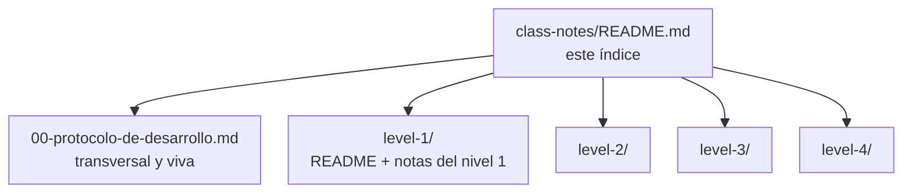

# Notas de clase de AdmitLens

**Qué vas a aprender.** AdmitLens se construye cuatro veces, en cuatro niveles de complejidad creciente, dentro de un mismo repositorio. Estas notas explican el código de cada nivel y el proceso con el que se planea y se construye: qué problema resuelve cada pieza, qué alternativa se descartó y dónde vive en el repo. Están escritas en español para un backend que se prepara para trabajar a nivel mid+.

## Contenido

1. [Índice de notas](#índice-de-notas)
2. [Cómo están organizadas](#cómo-están-organizadas)
3. [Cómo leerlas](#cómo-leerlas)

## Índice de notas

| Nota | Qué explica | Estado |
| --- | --- | --- |
| [00 — Protocolo de desarrollo](00-protocolo-de-desarrollo.md) | Cómo se planea y se construye el proyecto: la cadena de planeación, las salvaguardas de un repo público, el protocolo para sistemas que ya existen y el cierre de cada plan. Es una nota viva, transversal a los cuatro niveles | viva |
| [Nivel 1](level-1/README.md) | Monolito FastAPI síncrono sobre PostgreSQL 16 | en construcción |
| [Nivel 1 · 01 — Herramientas: Make, hooks, guardas y por qué](level-1/01-herramientas-make-hooks-y-guardas.md) | Makefiles, hooks de git, el motor de guardas, gitleaks fijado, `make env`, PostgreSQL en compose y CI | lista |
| Nivel 2 | Monolito modular asíncrono, multi-tenant, con workers y caché | pendiente |
| Nivel 3 | Servicios detrás de un gateway, con eventos y outbox | pendiente |
| Nivel 4 | El nivel 3 desplegado con un pipeline de CI/CD | pendiente |

## Cómo están organizadas

- **Una carpeta por nivel.** Cada nota va a la carpeta del nivel cuyo código explica, con un `README.md` que da el diagrama del nivel, cómo correrlo (solo con `make`) y una ruta de lectura.
- **La nota 00 es la excepción:** explica el proceso de todos los niveles y vive en la raíz de `class-notes/`.
- **Solo llegan notas finales.** Las notas se escriben y se revisan en un cuaderno privado del proyecto y se publican aquí cuando la parte que explican está terminada. Por eso las referencias a decisiones (por ejemplo, ADR-ADLN-0007) aparecen como texto: los documentos de decisión no están en el repo, y cada nota cuenta lo que deciden para que se entienda sola.
- **Las notas citan el código real** con enlaces relativos, como [`Makefile`](../Makefile) o [`tools/guards/guards/cli.py`](../tools/guards/guards/cli.py). Si una nota y el código no coinciden, manda el código: abre un issue.

## Cómo leerlas

- **Si empiezas:** la [nota 00](00-protocolo-de-desarrollo.md), secciones 1 y 2, y después la [nota 01 del nivel 1](level-1/01-herramientas-make-hooks-y-guardas.md).
- **Si vas a contribuir:** la nota 01 del nivel 1 explica por qué cada commit pasa por hooks y guardas, y [CONTRIBUTING.md](../CONTRIBUTING.md) explica cómo proponer un cambio.
- **Si te interesa el proceso:** la nota 00 entera. Cada sección está fechada y ninguna se reescribe: si algo cambia, lo cuenta la sección siguiente.

Cada nota termina con preguntas de repaso (con la respuesta plegada) y una sección «Para practicar».
