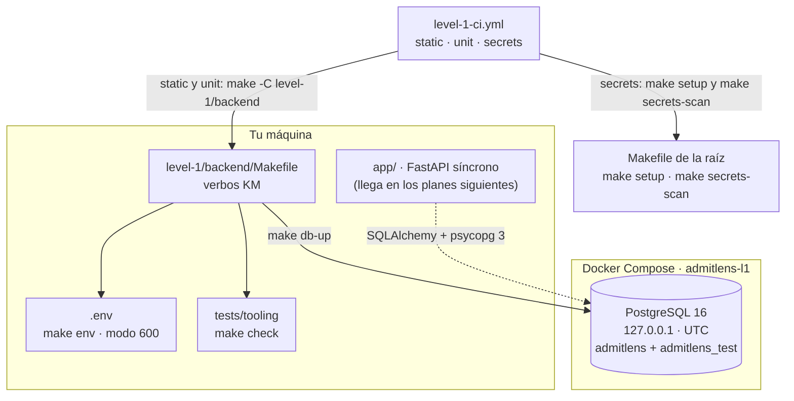

# Nivel 1: notas de clase

**Qué vas a aprender.** El nivel 1 de AdmitLens es un monolito FastAPI síncrono, con un dominio puro, sobre PostgreSQL 16. Estas notas explican el código del nivel a medida que se construye: primero las herramientas que lo rodean (Make, hooks, guardas, base de datos y CI) y después, en las notas siguientes, la aplicación. Cada nota cita los archivos reales del repo, para que puedas leer el código mientras la lees.

## Contenido

1. [La arquitectura en un diagrama](#la-arquitectura-en-un-diagrama)
2. [Cómo correr el nivel](#cómo-correr-el-nivel)
3. [Ruta de lectura](#ruta-de-lectura)
4. [Notas del nivel](#notas-del-nivel)

## La arquitectura en un diagrama

Hoy el nivel tiene su andamiaje: el proyecto Python, el `Makefile`, la base de datos en Docker y el CI. La aplicación (dominio, API, migraciones y carga de datos) llega en los planes siguientes; en el diagrama va con línea discontinua.



## Cómo correr el nivel

Todo pasa por `make`, también en CI. Desde la raíz del repo, una sola vez por clon:

```bash
make setup     # hooks de git, gitleaks fijado y configuración local de git
make doctor    # comprueba que todo esté en su sitio (imprime ok/warn/FAIL, nunca valores)
```

Después, dentro de `level-1/backend`:

```bash
make help      # lista todos los verbos del nivel
make install   # crea .venv desde uv.lock
make env       # crea .env con contraseñas generadas (nunca sobrescribe)
make db-up     # levanta PostgreSQL 16 y asegura la base admitlens_test
make check     # lint + tests sin base de datos (la compuerta del pre-push)
make test      # todos los tests, con cobertura (necesita make db-up)
make db-stop   # para la base y conserva sus datos
```

`make db-down` borra la base **y su volumen**: te pide escribir `admitlens-l1` en una terminal. Los verbos `migrate`, `seed`, `dev`, `openapi` y `openapi-check` ya existen, pero salen con código 2 y dicen qué plan los implementa.

## Ruta de lectura

1. [00 — Protocolo de desarrollo](../00-protocolo-de-desarrollo.md), secciones 1 y 2: cómo se planeó el proyecto y cómo se protegió el repo público.
2. [01 — Herramientas: Make, hooks, guardas y por qué](01-herramientas-make-hooks-y-guardas.md): todo lo que rodea al código antes de escribirlo.
3. Con la nota 01 abierta, lee en este orden: [`Makefile`](../../Makefile), [`.githooks/pre-commit`](../../.githooks/pre-commit), [`level-1/backend/Makefile`](../../level-1/backend/Makefile), [`ops/make-env.sh`](../../level-1/backend/ops/make-env.sh) y [`docker-compose.yml`](../../level-1/backend/docker-compose.yml).

## Notas del nivel

| Nota | Tema | Estado |
| --- | --- | --- |
| [01 — Herramientas: Make, hooks, guardas y por qué](01-herramientas-make-hooks-y-guardas.md) | Makefiles, hooks, `tools/guards`, gitleaks fijado, `make env`, PostgreSQL en compose y CI | lista |

Las notas de la aplicación (dominio, base de datos, API, carga de datos y frontend) se añaden aquí a medida que se construye cada parte.
